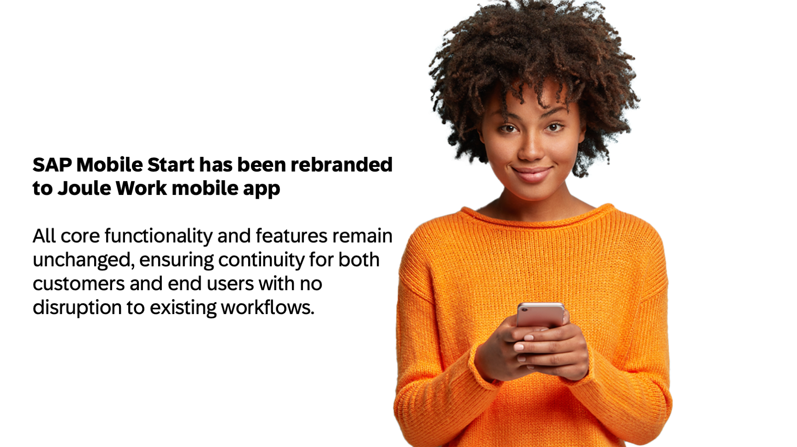
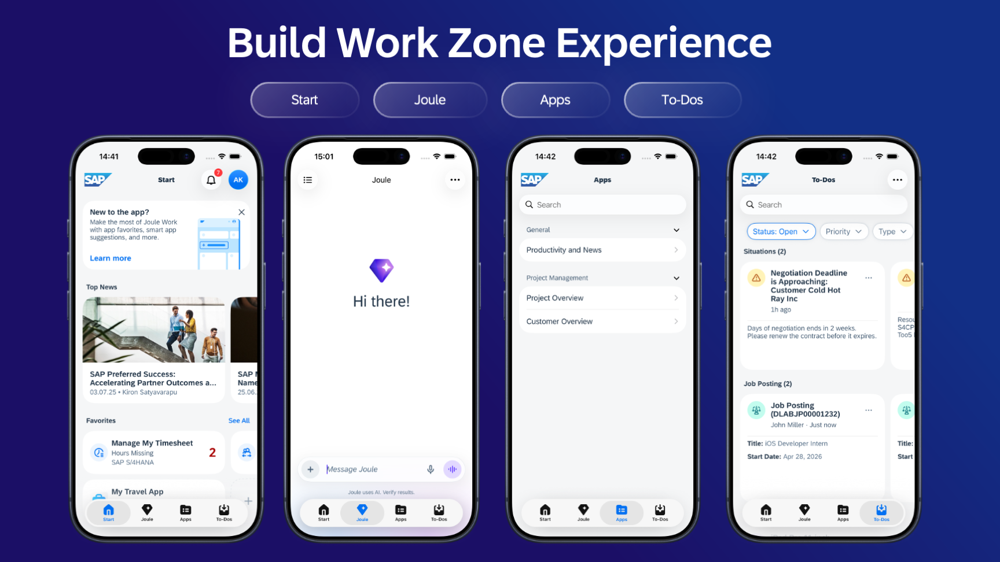
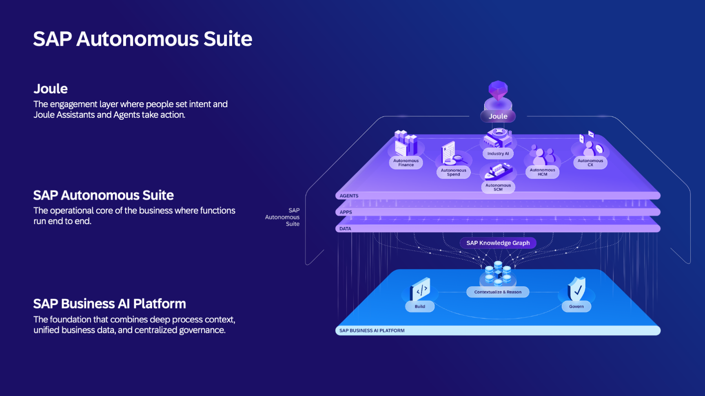
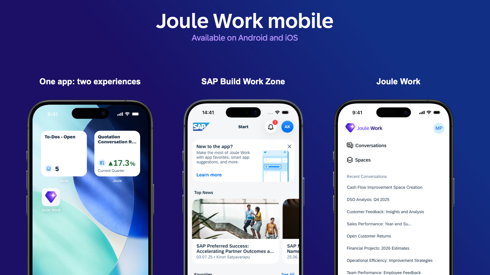
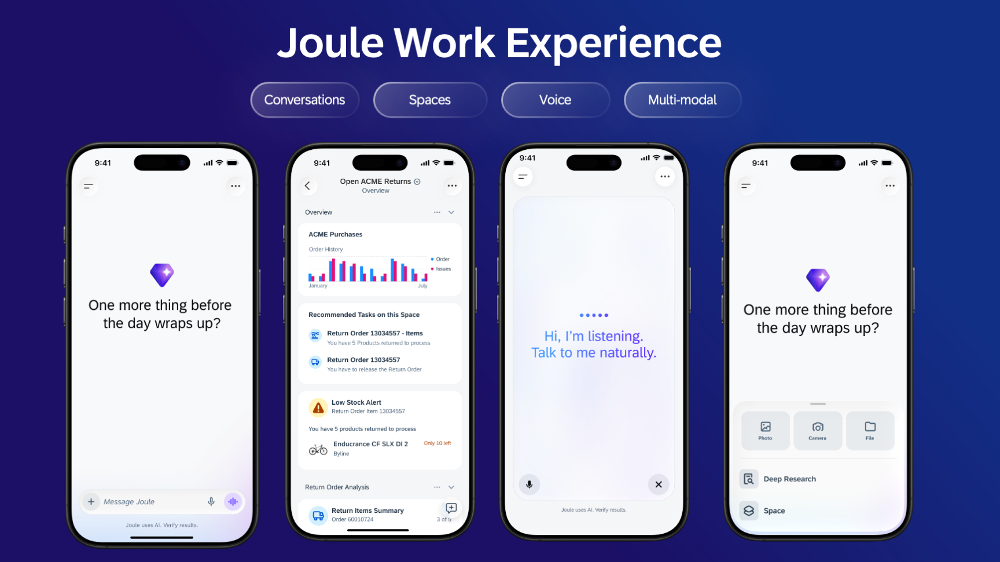

# Exercise 0 - Getting started: the Joule Work mobile app and the big picture

Before you touch the app, this exercise gives you the context you need to make sense of what follows. There is nothing to click here. Read it, look at the slides your instructor presents, and you will understand *why* the app looks and behaves the way it does in the rest of the session.

## From SAP Mobile Start to the Joule Work mobile app

The app you use today was formerly known as **SAP Mobile Start**. With version 3.0, released around SAP Sapphire this year, it was rebranded to the **Joule Work mobile app**. It is a native mobile app for Android and Apple platforms.

The rebranding kept all existing capabilities intact. Everything SAP Mobile Start could do, the Joule Work mobile app still does. What changed is the name, the icon, and, more importantly, a new way to connect the app, which you explore in the second half of this session.

> [!NOTE]
> If you already have SAP Mobile Start on your device, it is the same app under a new name. There is no separate download.
>
> If you want to learn more, you can read our [blog post on the SAP Community](https://community.sap.com/t5/technology-blog-posts-by-sap/sap-mobile-start-rebranding-of-the-app-enhanced-joule-and-improved-single/ba-p/14391824) about the rebranding of the app.

## SAP Build Work Zone and the central entry point

For years, SAP's strategy has been to give every user a **single, central entry point** into their SAP landscape rather than a separate login for every product. On the desktop, that entry point is **SAP Build Work Zone**. On mobile, it is this app.

SAP Build Work Zone comes in editions, and the app supports all of them:

| Edition | Description |
| --- | --- |
| SAP Build Work Zone, standard edition | The foundation: a launchpad that federates apps and content from your SAP systems. |
| SAP Build Work Zone, advanced edition | Adds collaboration features such as Workspaces on top of the standard edition. |
| SAP SuccessFactors Work Zone | The Work Zone experience tailored for the HR line of business, based on the advanced edition. |

> [!IMPORTANT]
> This session uses **SAP Build Work Zone, advanced edition** for the first half. The Workspaces feature you explore in Exercise 4 is specific to the advanced edition.

Connected to SAP Build Work Zone, the app is your **mobile-native entry point to the Intelligent Enterprise**: your apps from SAP S/4HANA Cloud and other systems, your tasks, your notifications, and Joule, all in one place on your phone.

## The Autonomous Enterprise and Joule Work

SAP's direction is the **Autonomous Enterprise**: business processes that run with AI at their core, where Joule acts as the copilot and agent across the SAP landscape. **Joule Work** is the product that brings this AI-native experience together as the next-generation working environment.

The Joule Work mobile app supports this transition. The app can connect **directly to Joule Work** as the underlying product. For a customer moving toward the Autonomous Enterprise, the same app on the same device becomes the mobile front door to Joule Work.

## Two experiences, one single app

The app offers **two experiences**:

| Experience | Connects to | What you get |
| --- | --- | --- |
| **SAP Build Work Zone experience** | SAP Build Work Zone (standard, advanced) or SAP SuccessFactors Work Zone | The mobile-native entry point to your Intelligent Enterprise: apps, Workspaces, to-dos, notifications, and Joule. |
| **Joule Work experience** *(new in v3.0)* | Joule Work directly | The AI-native experience built around Joule: Conversations and Spaces, without needing an SAP Build Work Zone backend. |

You experience **both** today. In Part 1 you connect to SAP Build Work Zone, advanced edition. In Part 2 you switch the same app to Joule Work and experience its features and functionalities.

## Core features of Joule Work

When connected to **Joule Work**, the experience is organized around Joule itself:

- **Conversations** - natural-language chats with Joule. Ask questions, invoke skills, and let Joule take action across your connected SAP systems.
- **Spaces** - focused working contexts that keep related conversations, content, and context together for a topic, project, or process.
- A **consistent experience across web and mobile**, so a conversation or space you start on one device continues on the other.

You explore these in detail in Exercises 7 to 9. The exact feature set is detailed there.

## Summary

You now know the essentials: the app was SAP Mobile Start and is now the Joule Work mobile app; it is the mobile entry point to SAP Build Work Zone in all its editions; and it also connects directly to Joule Work as part of SAP's move to the Autonomous Enterprise. You saw that one app offers two experiences, and that this session covers both, starting with SAP Build Work Zone, advanced edition.

Continue to - [Exercise 1 - Access SAP Build Work Zone in the browser](../ex1/README.md)
