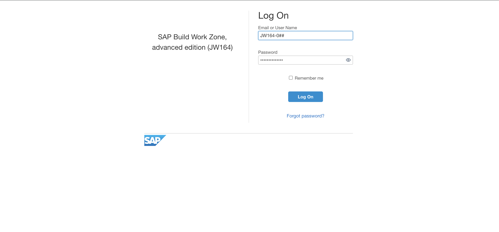
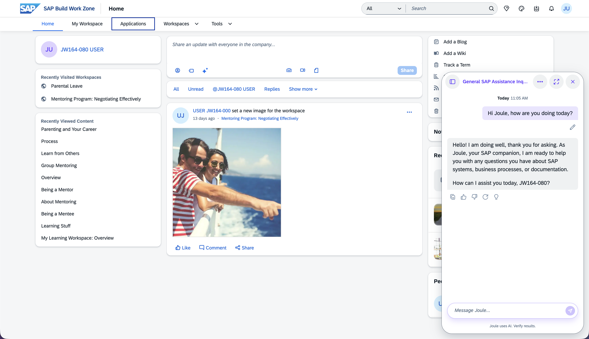
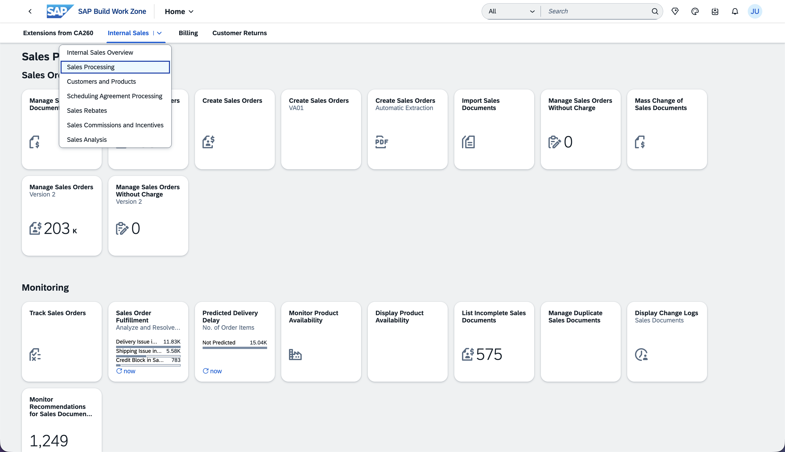
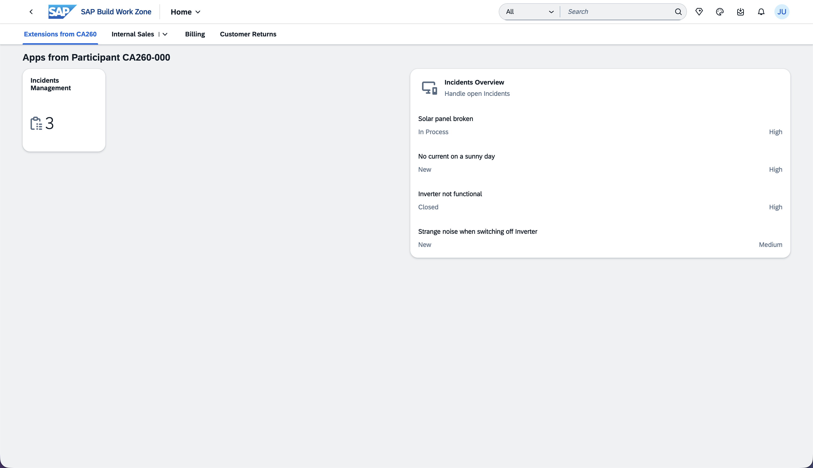
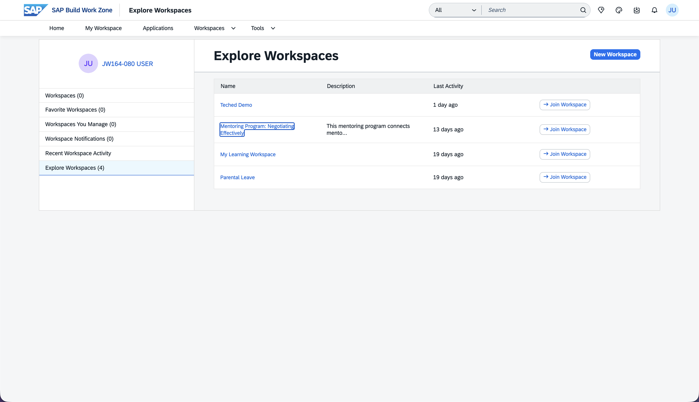
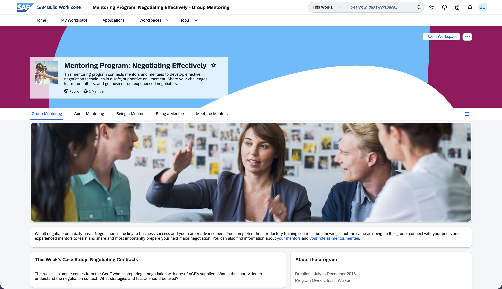
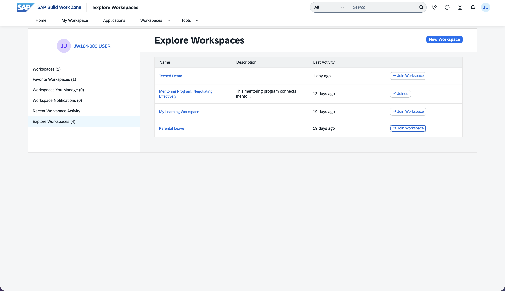

# Exercise 1 - Access SAP Build Work Zone in the browser

In this exercise you sign in to the SAP Build Work Zone, advanced edition site that has been prepared for this session. You start on the desktop browser of the computer at your workshop desk. This is the same site your mobile app connects to in the next exercise, so getting familiar with it here helps you recognize the content later on your phone.

> [!CAUTION]
> You do **not** need to sign in into Github for this exercise. You only need to sign in into SAP Build Work Zone below and in part 2 into Joule Work, both on web and mobile.

## Exercise 1.1 Sign in to SAP Build Work Zone

1. On the computer at your desk, open a browser and go to the SAP Build Work Zone, advanced edition site:

    ```text
    https://jw164-djmbomr8.eu10.workzone-advanced.cloud.sap/
    ```

2. When prompted, sign in with the user provided for your desk.

    - Your username is `JW164-0##`, where `##` is your **desk number**. For example, desk number `7` is `JW164-007` and desk number `42` is `JW164-042`.
    - The password is the one the instructor gave you at the start of the session.

> [!CAUTION]
> Use **your** assigned desk number and the **same** number consistently throughout the whole session. The content, favorites, and Workspaces you work with are tied to your user. Using a different number in a later exercise means you will not see the same content and might interfere with other participants.



## Exercise 1.2 Get to know SAP Build Work Zone

After signing in you land on the home page of SAP Build Work Zone, advanced edition. Take a moment to look around, because you will recognize this content on your phone shortly.

1. Notice the **shell bar** across the top: the search, the Joule diamond icon (top right), and your user avatar.

2. Click on the **Joule diamond** and say hi. After Joule has responded, you can close the chat overlay for now.

3. Now look at the **navigation bar** across the top. SAP Build Work Zone organizes content multiple areas. One is "Applications", which resembles the feature set of the standard edition. Additopnally the advanced edition content and its collaborative features live under Homepage and Workspaces.

4. Click on **Applications**. There you see the content structured in **Spaces** and **Pages**, shown via the menu bar. **Spaces** are the top-level menu entries. We did land on the Space **Extensions from CA260**. This is an example of a Space with only one **Page** which we are seeing in the content area. Typically, **Spaces** can have multiple **Pages** as sub-menu items, for example  **Internal Sales** next to which a dropdown chevron is showing. On a page, content is typically grouped using **Sections** to structure content like app tiles and cards that are relevant to a topic or role.

5. For now, let's stay on the Page of Space **Extensions from CA260** in the top-level tabs. This is a custom extension built using the SAP Cloud Application Programming Model (CAP) and Fiori Elements. You should see an app that displays the number of open incidents and a UI Integration Card showing the most recent open incidents in a list.

> [!TIP]
> [CA260 was last year's SAP TechEd Session](https://github.com/SAP-archive/teched2025-CA260) on how to build mobile ready extensions. If you are interested, you can check it out on your own after this hands-on workshop.

6. We have configured apps from SAP S/4HANA Public Cloud Edition. Since you have the **Sales** business role, you are seeing the relevant content only. Now, go to the Space **Internal Sales** and select the Page **Sales Processing** via the **dropdown**. Observe the available apps and how they are structured in Sections.

7. Navigate back to the **Homepage** by clicking on **SAP Build Work Zone** at the top left. The main navigation with **Workspaces** reappears.

8. Click on **Workspaces** in the navigation bar.

9. On the page that opens now, select **Explore Workspaces**. This is the list of (public) Workspaces you can join, that were created by your company or individual users. We have prepared some HR related sample Workspaces for you, let's check them out.

10.  Find the **Mentoring Program: Negotiating Effectively** entry and click on the name. Look around, this example Workspace is for a Mentoring Program offered by the example company's HR department, offered to the employees to gather relevant information and to collaborate as part of the process.

11.  Since that sounds interesting, click on **Join Workspace** at the top right.

12.  Let us even add it to our **Favorites** by clicking on the **star icon** next to the Workspace title.

13.  Now, let's go back to the list, and click on **Join Workspace** for the **Parental Leave** workspace.













> [!TIP]
> The Joule diamond icon in the top right is Joule inside SAP Build Work Zone. You use it in Exercise 5. Its presence here is what makes Joule appear automatically in the mobile app too.

## Summary

You signed in to the prepared SAP Build Work Zone, advanced edition site with your desk user and got oriented: the shell bar, the spaces and pages structure, and the app tiles available to you. Then we headed to the workspace and collaborative content types available in the advanced edition. This same content becomes available on your phone once you connect the app in the next exercise.

Continue to - [Exercise 2 - Onboard the Joule Work mobile app](../ex2/README.md)
