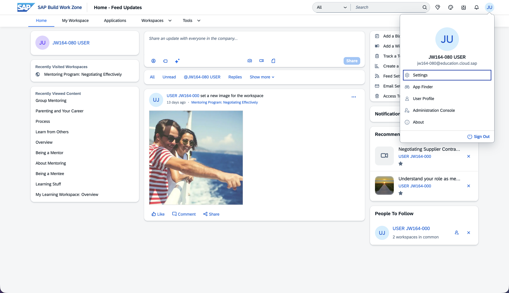
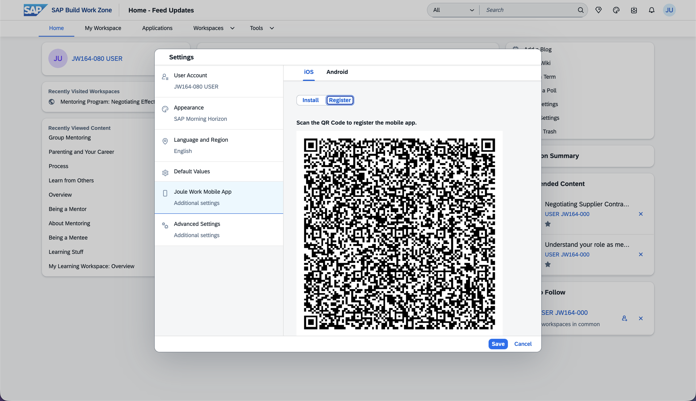
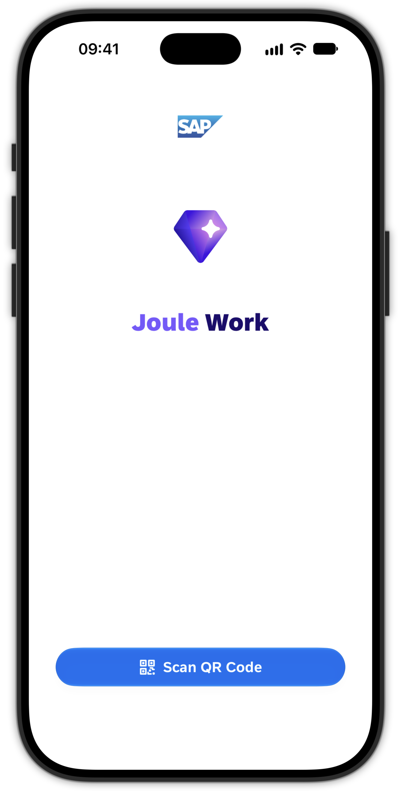
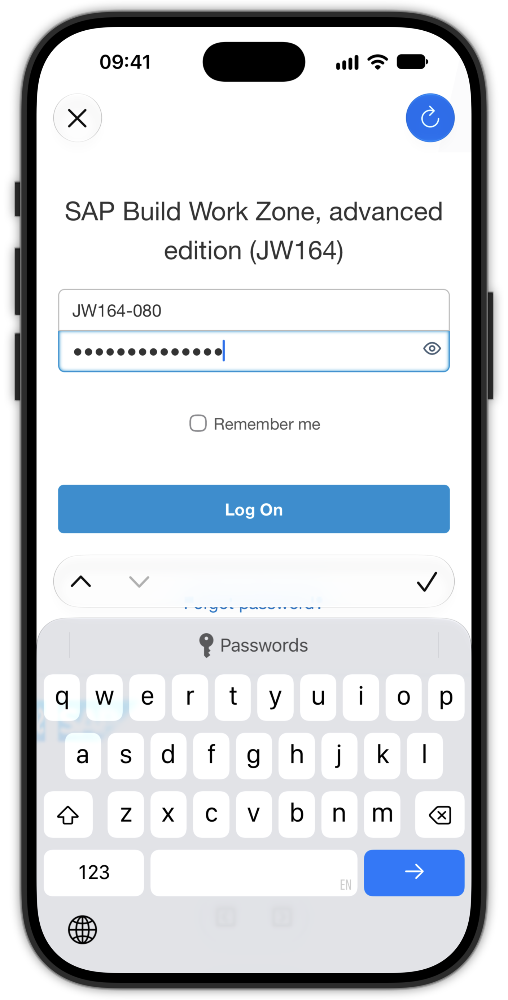
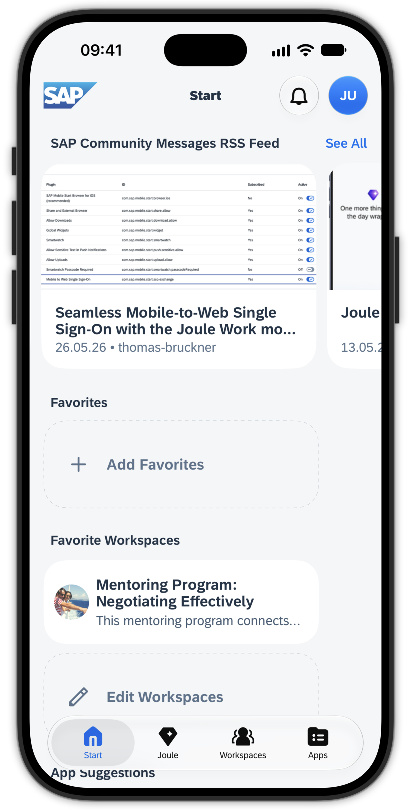

# Exercise 2 - Onboard the Joule Work mobile app

Now you bring the app onto your own phone and connect it to the same SAP Build Work Zone site you just explored in the browser. Connecting the app to a backend for the first time is called **onboarding**. In this exercise you onboard using a **QR code** generated from your Work Zone profile.

## Exercise 2.1 Download the Joule Work mobile app

1. On your smartphone, open the app store for your platform and search for **Joule Work**.

    - Apple Platforms: [Apple App Store](https://apps.apple.com/app/joule-work/id1540195902)
    - Android: [Google Play Store](https://play.google.com/store/apps/details?id=com.sap.mobile.apps.sapstart)

2. Install the app (in case you don't have the app already). The download can take a moment depending on the network, so start it now and continue reading while it installs.

> [!NOTE]
> If you already had **SAP Mobile Start** on your device, that is the same app. It may already be updated to the Joule Work mobile app. You can use it as-is. You switch its connection between environments using the **Switch Environment** feature.

## Exercise 2.2 Find the Register QR code in SAP Build Work Zone

The QR code that connects the app to your site is generated in your SAP Build Work Zone user profile, in the browser.

1. Back in the browser on your SAP Build Work Zone site, click your **user avatar** in the top-right shell bar and open **Settings**.

2. Select **Joule Work Mobile App** from the left sidebar.

3. Switch to the **Register** tab. A QR code is displayed.

> [!CAUTION]
> This screen shows **two** QR codes:
>
> - An **Installation** QR code, which only links to the app store and does **not** connect the app.
> - A **Register** QR code, which performs the actual connection to your site.
>
> Scan the **Register** QR code. Scanning the wrong one is the most common onboarding mistake.

## Exercise 2.3 Connect the app

1. Open the Joule Work mobile app on your phone. Accept the license and privacy statement.

2. Tap **Scan QR Code** and allow camera access when prompted.

3. Scan the **Register** QR code from your browser.

4. Authenticate with the same user you used in Exercise 1 (`JW164-0##` and the session password).

> [!CAUTION]
> If this is a fresh install, your phone asks whether the app may send **push notifications**. Choose **Allow** so notifications work as expected.
>
> In case you use the app already on your device productively, you can still use it for this session, by leveraging the **Switch Environment** feature available in the Profile and Settings screen.
> It let's you switch to this SAP TechEd's environment for this session and later back to your company's landscape.

  
  
  

After onboarding completes, the app loads your content. We will explore this content in the next exercises.

## Summary

You installed the Joule Work mobile app on your own device and onboarded it to your SAP Build Work Zone, advanced edition site by scanning the **Register** QR code from your SAP Build Work Zone profile. The app now mirrors the content available to your user. Keep the app open. In the next exercise you start exploring your apps & content.

Continue to - [Exercise 3 - Explore your apps](../ex3/README.md)
