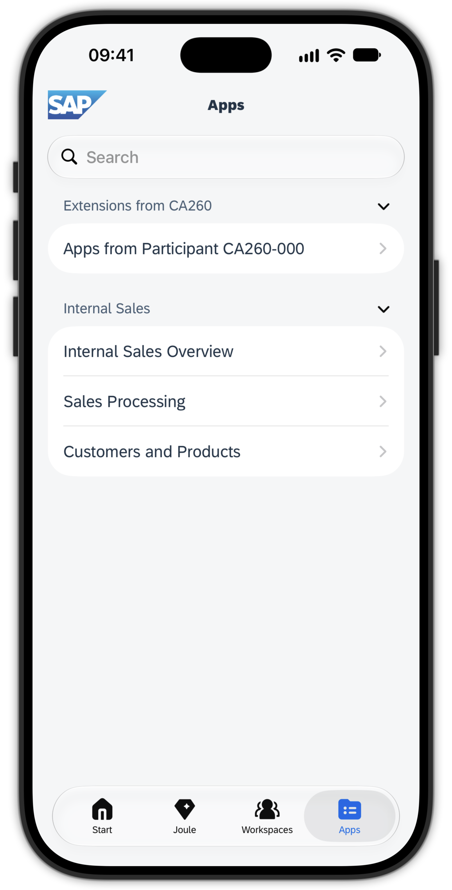
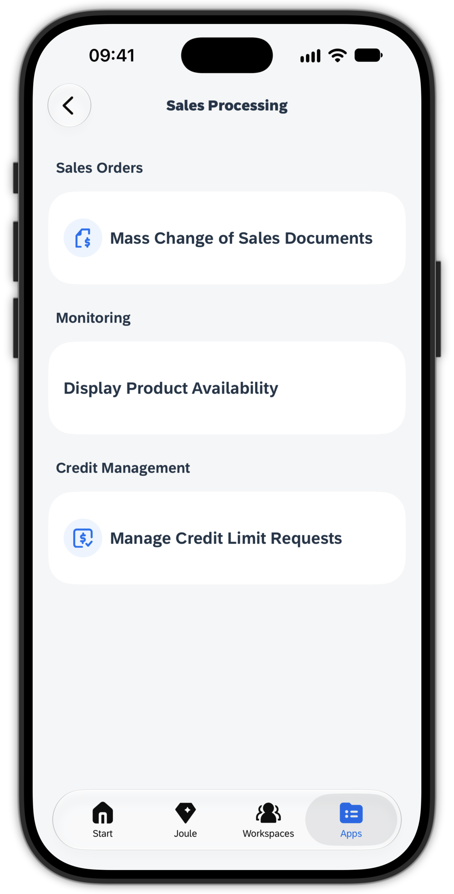
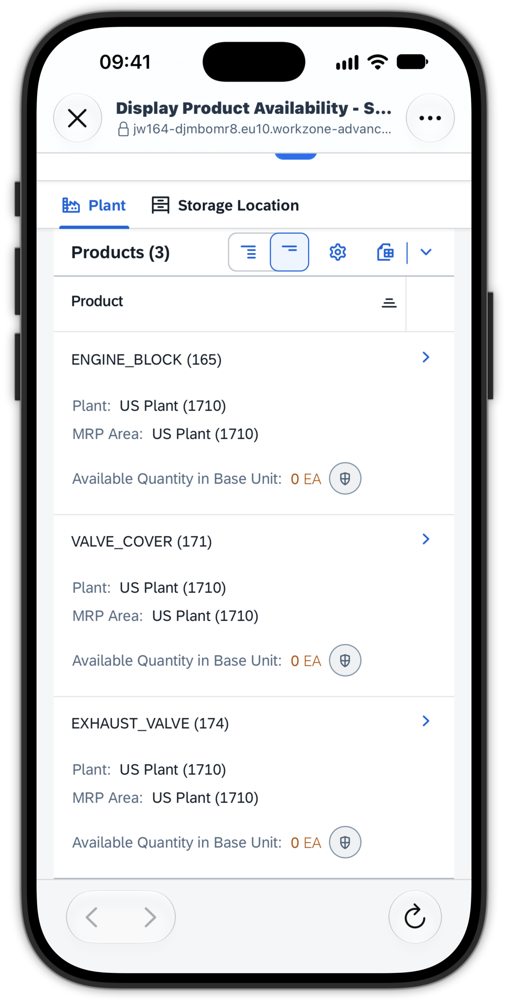
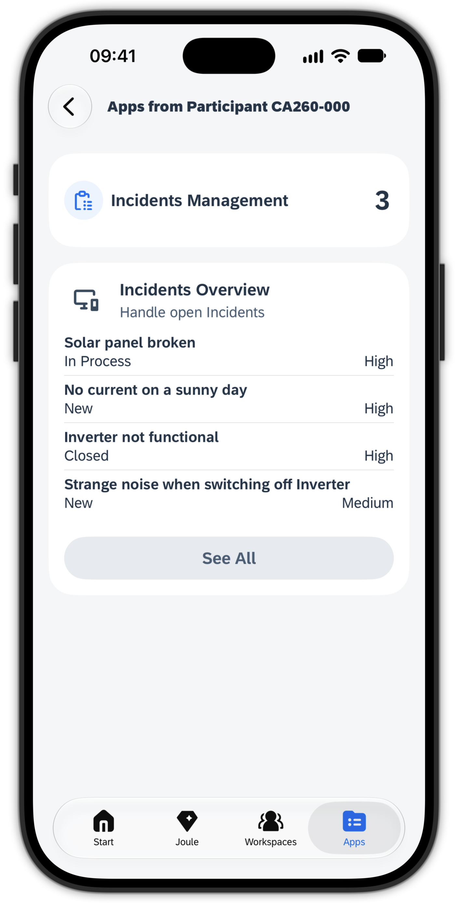
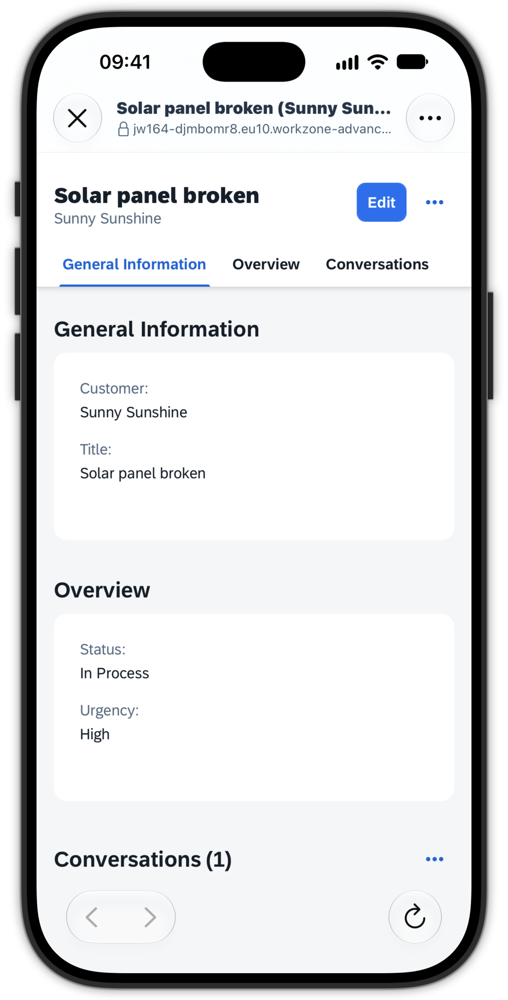
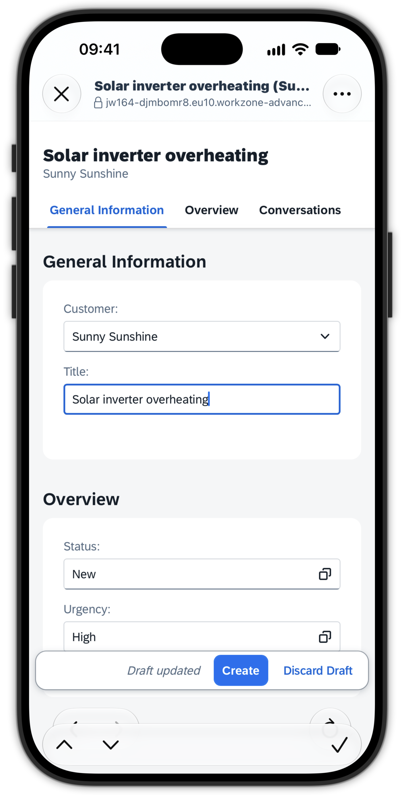
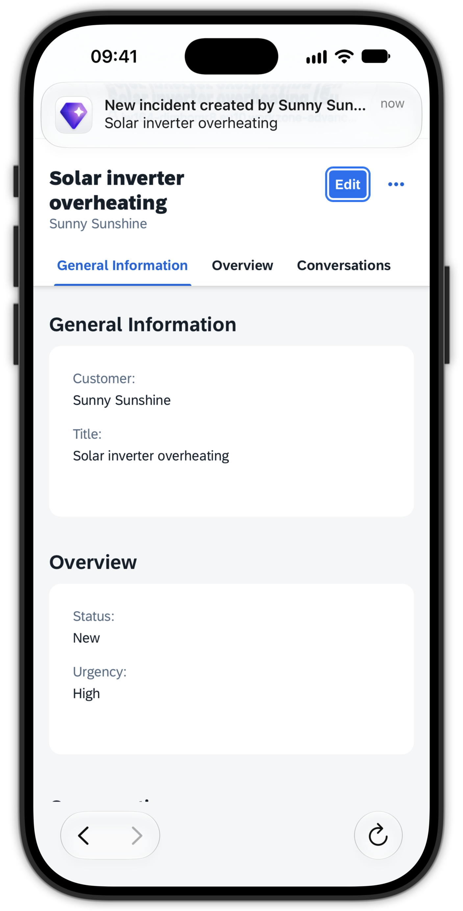
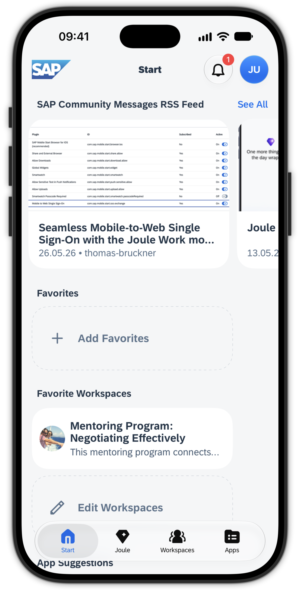
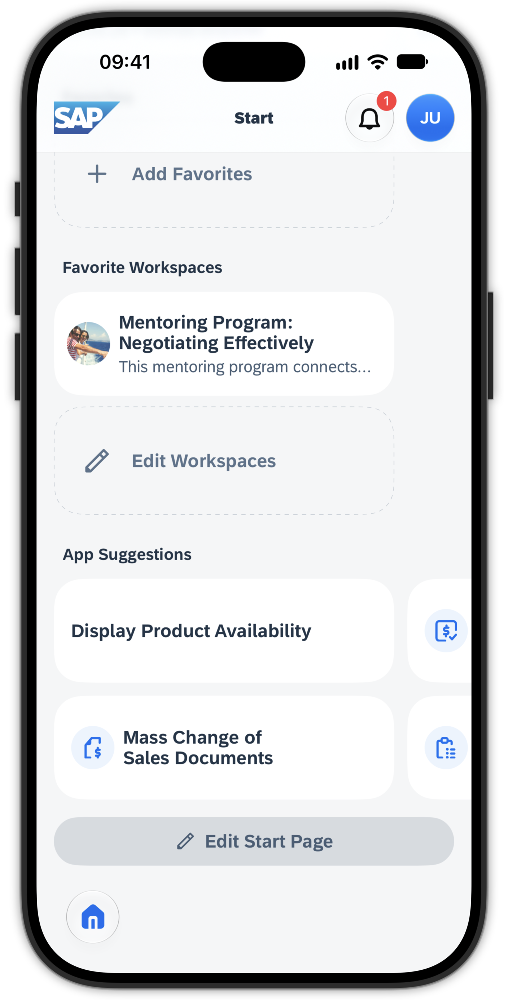
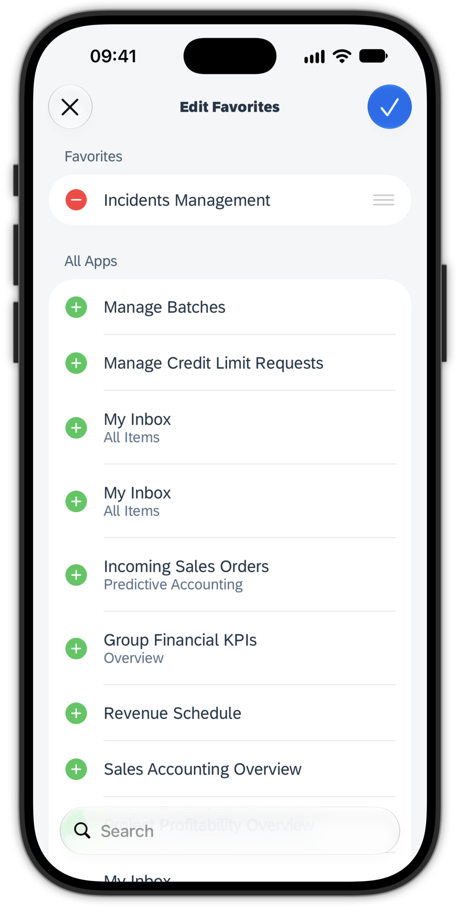

# Exercise 3 - Explore your apps

With the app connected to your SAP Build Work Zone site, you start where most users spend their time: their apps. In this exercise you browse the same spaces and pages you saw in the browser, launch a business app from SAP S/4HANA Cloud, work with a custom extension and its UI Integration Card, create an incident that triggers a push notification, and take a look at the Start screen.

## Exercise 3.1 The Apps tab

1. In the Joule Work mobile app, open the **Apps** tab at the bottom.

2. Notice that your content is organized into the same **Spaces** and **Pages** structure you saw in the browser in Exercise 1. The mobile app mirrors the site configuration; there is nothing separate to set up.

  

## Exercise 3.2 Launch an app from SAP S/4HANA Cloud

1. Open the Space **Internal Sales** and then the Page **Sales Processing**, the same location you visited in the browser.

2. Observe that the apps are again grouped into **Sections**, but that you see **fewer** apps than in the browser.

> [!TIP]
> Whether an app appears in the mobile app depends on whether it is flagged to support the current **form factor** (phone or tablet). Apps that are not enabled for the phone form factor are hidden here, so users only see what is meaningful to use on the device in front of them.
> 
> To find out which form factors an app supports, check the [SAP Fiori Apps Reference Library](https://fioriappslibrary.hana.ondemand.com/). It documents the apps delivered by SAP, including their supported device types.

3. Launch the app **Display Product Availability**.

4. The app opens in an **optimized in-app browser**. Notice that it launches **without the shell header** you know from the desktop launchpad.

5. Use the Fiori App to search for some product availability by choosing some products via the filters and search for its availabilities.

> [!NOTE]
> Fiori apps exposed to the Joule Work mobile app through SAP Build Work Zone launch in this optimized in-app browser, giving seamless access to the business process. There is no shell header because apps in the Joule Work mobile app are designed for **quick access** to a relevant business process. After finishing your task you simply close the app.

5. Close the app using the **X** / **Close** button to return to the Apps tab.

  
  

## Exercise 3.3 Experience custom-built extensions

1. Navigate back to the **Spaces** overview of the Apps tab.

2. Like in Exercise 1, open from the Space **Extensions from CA260** the Page **Apps from Participant CA260-000**.

3. Observe the custom-built extension, exposed as a **KPI Tile** showing the number of open incidents.

4. Below it, the **UI Integration Card** you saw in the browser is also displayed, rendered natively in the mobile app.

5. On the card, tap **See all** to open the full list as a detail view of the UI Integration Card.

6. Select one incident. This launches the optimized in-app browser and **deep-links** into the CAP app directly at the selected incident.

7. Go back to the Page **Apps from Participant CA260-000**, then open the **Incidents Management** app and create a **new incident**, where you need to **Select a customer from the dropdown** and give it a **title**. Then click **Create** in the bottom bar.

> [!CAUTION]
> All participants of this workshop share the same system and see **all** incidents. Pick a meaningful, recognizable title (for example, include your desk number) so you can find yours again.

8. After the incident is created, you receive a **push notification** informing you about it.

> [!NOTE]
> This shows the integration of mobile features such as **notifications**, which keep users informed about important business situations and events proactively.

> [!TIP]
> [CA260 was last year's SAP TechEd Session](https://github.com/SAP-archive/teched2025-CA260) on how to build mobile ready extensions. If you are interested, you can check it out on your own after this hands-on workshop.

  
  

  
  

## Exercise 3.4 The Start tab

1. Switch to the **Start** tab.

2. Look at the **SAP Community Messages RSS Feed** news section, configured by the administrator. For this session we have configured it to show blog posts in the **SAP Community**. This is a convenient way to integrate company news into the mobile app for keeping employees up-to-date.

3. Scroll down to **App Suggestions** now, which suggests relevant apps for the current situation.

> [!NOTE]
> App Suggestions learns from your usage patterns. For example, if you typically do your time recording on Friday afternoons from the mobile app, it learns this and suggests that app to you on Friday afternoons.

4. Look at the **Favorites** section, where you can add your app favorites. Add one and access the web app from the Start tab.

> [!TIP]
> Favorites can be use to pin relevant apps, used often, for a quicker access. Favorites sync across your mobile devices using the Joule Work mobile app.

  
  
  

## Summary

You explored how the app surfaces your business apps: the Apps tab with the same spaces and pages as the browser, a live SAP S/4HANA Cloud app in the optimized in-app browser, and a custom extension with a UI Integration Card. You created an incident and received a push notification, seeing how mobile features keep you informed. Finally you looked at the personalized Start tab with Company News, App Suggestions, and Favorites.

Continue to - [Exercise 4 - SAP Build Work Zone, advanced edition Workspaces on desktop and mobile](../ex4/README.md)
