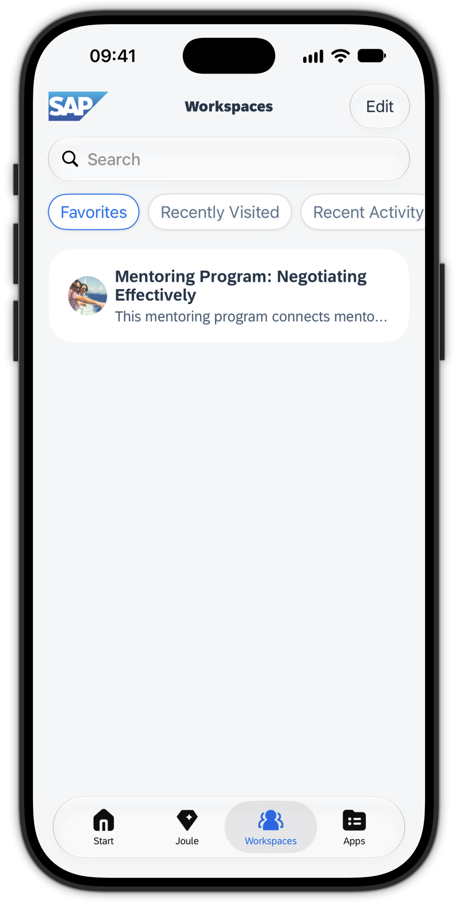
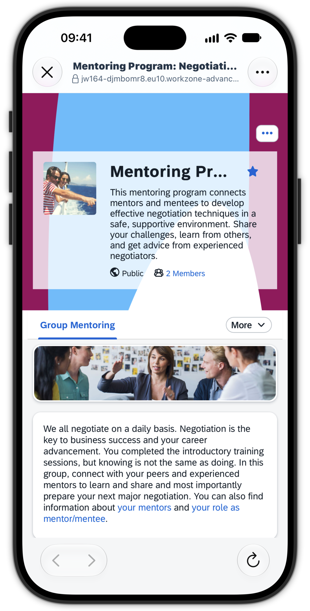
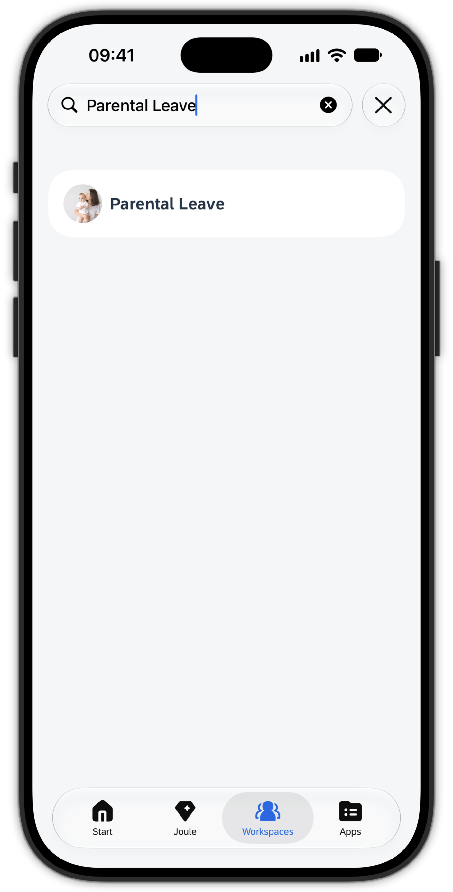
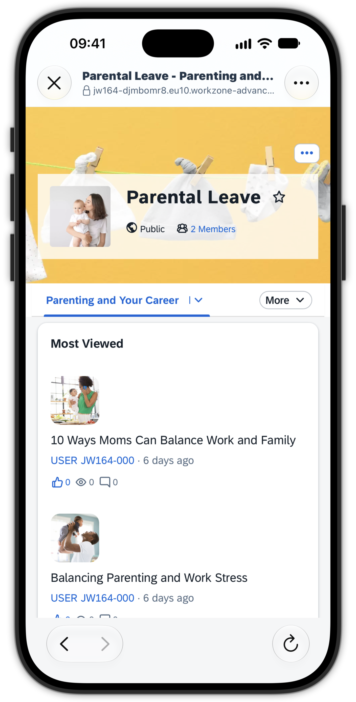
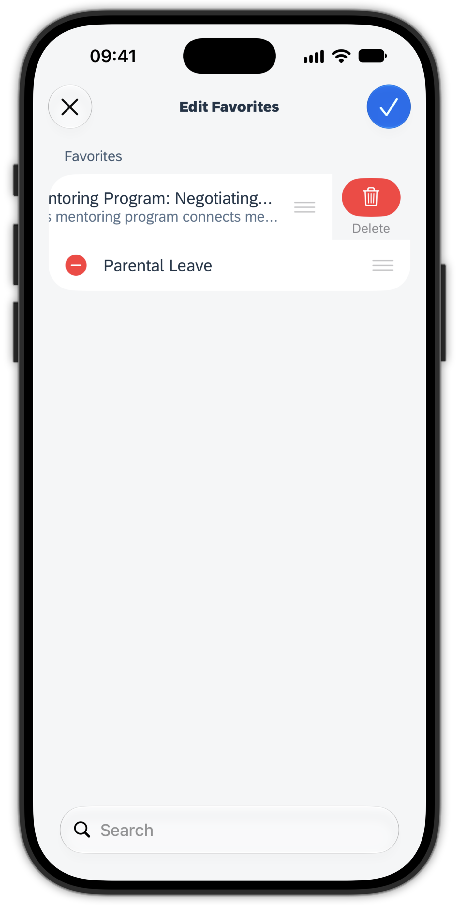

# Exercise 4 - Workspaces in the Joule Work mobile app

Workspaces are a collaboration feature of SAP Build Work Zone, advanced edition: team and project spaces that bring people, content, and tools together. You already joined a few Workspaces in the browser in Exercise 1. In this exercise you see how those Workspaces appear on your phone and how you work with them on the go.

## Exercise 4.1 Open a Workspace from Favorites

1. In the Joule Work mobile app, open the **Workspaces** tab. Here the Workspaces of SAP Build Work Zone, advanced edition become accessible.

2. You initially see your list of **Favorites**. Because you favorited **Mentoring Program: Negotiating Effectively** in Exercise 1, it is visible here.

3. Tap **Mentoring Program: Negotiating Effectively** and watch it load in a mobile-optimized way, again **without any shell bar** so that the focus stays on the Workspace itself.

4. Look around and explore the content you saw earlier on the desktop browser, now on your phone. You have access to the same collaboration features and information sources.

5. Close the Workspace to return to the Workspaces tab.

  
  

## Exercise 4.2 Find another Workspace you joined

1. Use the **Search** in the Workspaces tab to find the **Parental Leave** Workspace you joined in Exercise 1.

2. Open the Workspace from the search results and have a look around.

3. Now close the Workspace, cancel the search and select another filter in the **Workspaces** tab, e.g. **Recently Visited**, which will now also show the **Parental Leave** Workspace.

> [!NOTE]
> Only Workspaces where you have an **active membership** are displayed in the Joule Work mobile app. This keeps the focus on content that is relevant to you, which matters most when you use your phone on the go.

  
  

## Exercise 4.3 Manage your Workspace Favorites on mobile

1. Now, click on Edit to edit your favorite Workspaces. The **Edit Favorites** screen should appear.

2. Here you can manage your Favorites, like removing, adding and ordering.

3. Let's remove the **Mentoring Program** Workspace and add the **Parental Leave** Workspace instead.

> [!TIP]
> Workspace Favorites do sync with SAP Build Work Zone, advanced edition on the web. Workspace Favorites are stored on the level of your user.

  

## Summary

You opened your favorited Workspaces on the phone, saw them render in a focused, mobile-optimized way without a shell bar, and searched for another Workspace you joined earlier. You also saw that only Workspaces with an active membership appear in the app, keeping the mobile experience focused on what is relevant to you.

Continue to - [Exercise 5 - Chat with Joule in the mobile app](../ex5/README.md)
