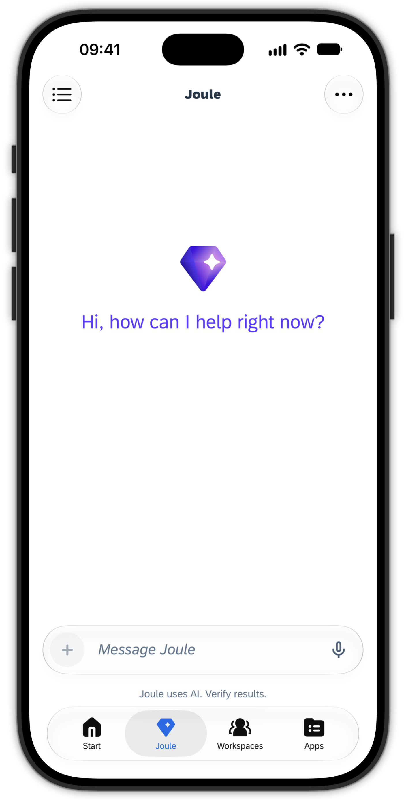
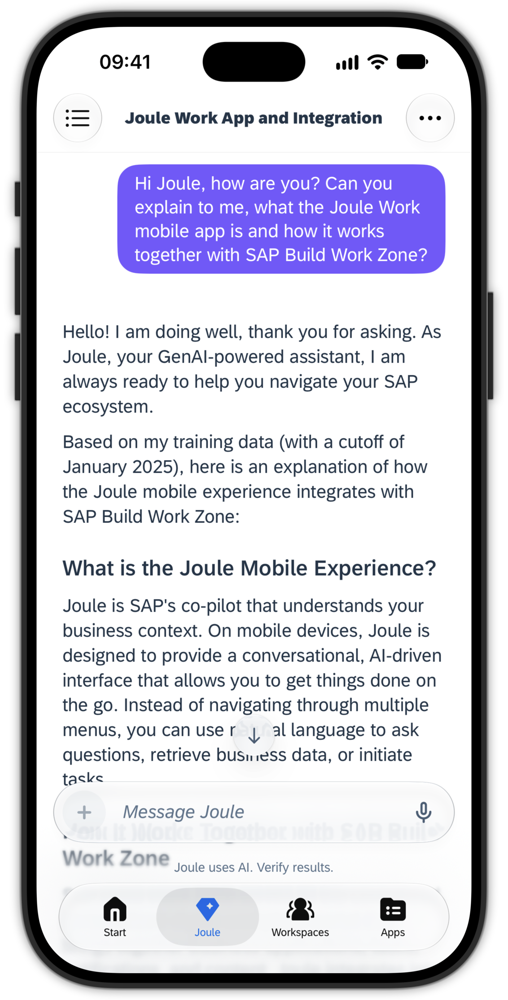
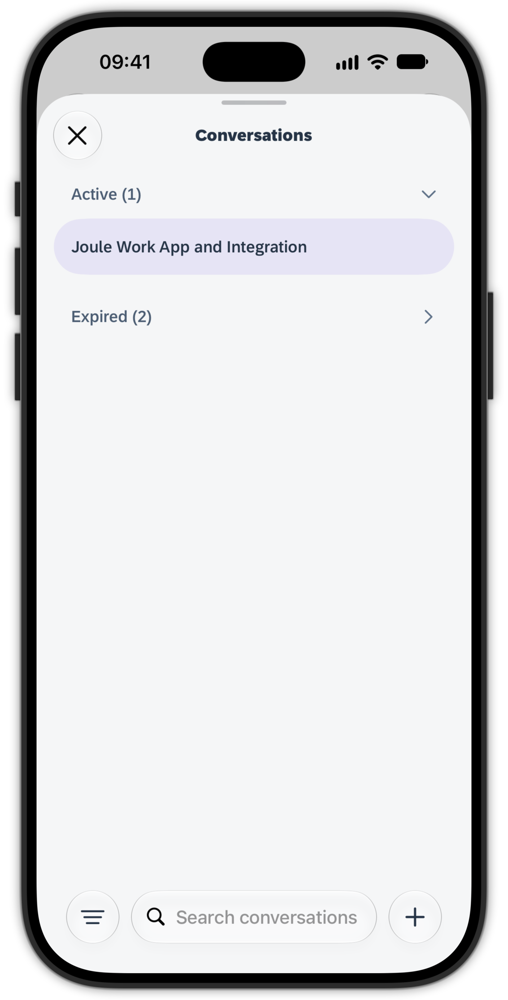

# Exercise 5 - Chat with Joule in the mobile app

Joule is SAP's generative AI copilot. You already met Joule in the browser on your SAP Build Work Zone site. In the Joule Work mobile app, Joule has its own tab so you can chat with it directly from your phone. In this exercise you start a conversation, browse your conversation history, and open a new conversation.

## Exercise 5.1 Start chatting with Joule

1. Switch to the **Joule** tab, the same Joule you used previously on SAP Build Work Zone in the desktop browser.

2. Try it out: have some initial small-talk conversation with Joule and see how it responds.

  
  

## Exercise 5.2 Browse and start conversations

1. On the **top left**, open the **Conversations** list, for example to continue a previous conversation.

2. Open a **new conversation** from the conversation list using the **plus (+)** button at the bottom right.

  
  

## Summary

You used Joule directly from the Joule tab in the mobile app: you started a conversation, opened the Conversations list to revisit earlier chats, and created a new conversation.

Continue to - [Exercise 6 - Behind the scenes: SAP Mobile Services (read-only)](../ex6/README.md)
