# Exercise 6 - Behind the scenes: administration (read-only)

The mobile experience you have used so far is administered from two places: the **SAP Build Work Zone Site Manager**, where the non-mobile-specific content is managed, and the **Mobile Services Admin Cockpit**, where the Joule Work mobile app itself is configured. In this exercise you take a read-only tour of both to understand what an administrator sets up for you.

> [!NOTE]
> You have been given a **read-only admin** access. You can view the admin interfaces, but you cannot change any settings.

## Exercise 6.1 The SAP Build Work Zone Site Manager

1. Open the Site Manager at [https://jw164-djmbomr8.dt.eu10.workzone-advanced.cloud.sap/](https://jw164-djmbomr8.dt.eu10.workzone-advanced.cloud.sap/). This is the Site Manager that exists in every SAP Build Work Zone edition. Here the (non advanced-edition specific) content is managed, along with further settings for the app-focused area.

    ```
    https://jw164-djmbomr8.dt.eu10.workzone-advanced.cloud.sap/
    ```

2. On the left is the menu of the different areas. **Site Directory** lists the available sites. In the standard edition you could create several sites here; the advanced edition is focused on a single one. Using the **gear** icon on the **SAP Build Work Zone** site, you could adjust site settings and the behavior of the **Apps** area in SAP Build Work Zone, advanced edition.

    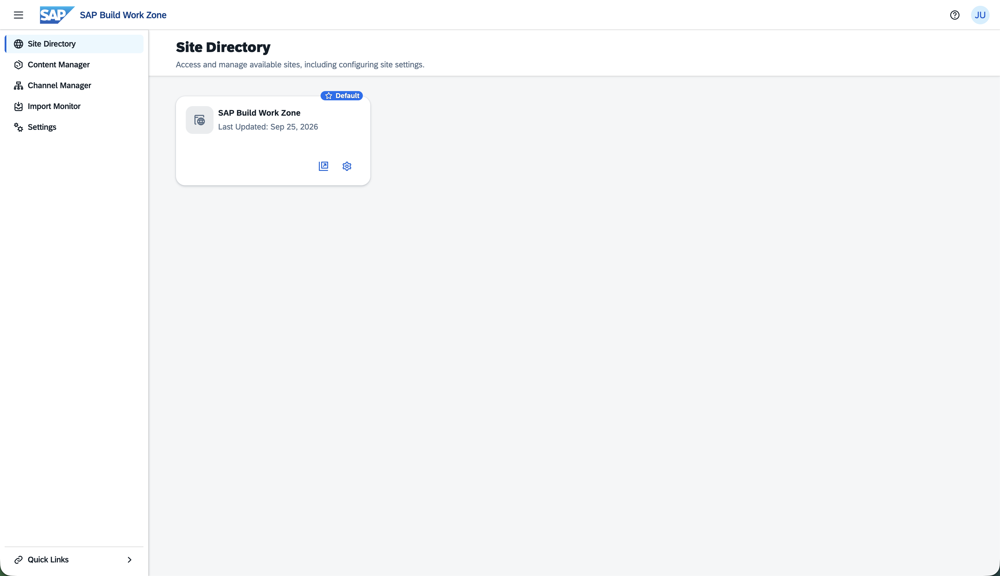

3. Open **Content Manager**. This is where content is managed, for example creating apps that should also be placed on Spaces and Pages.

    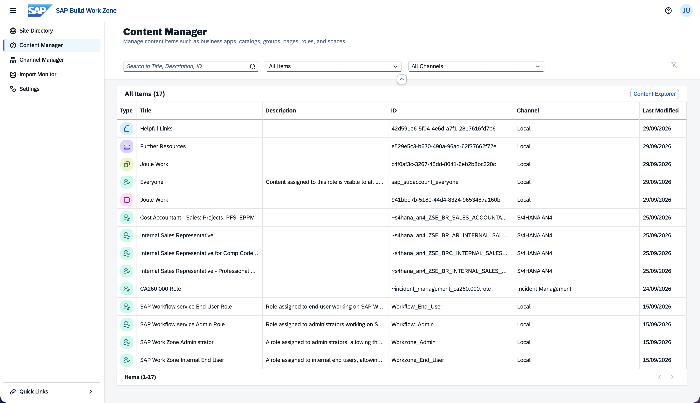

4. Open **Channel Manager**. This is where channels to content providers are managed, for example the content exposure from SAP S/4HANA that we set up for this session, or the custom extension for **Incidents Management** which is built as an HTML5 business solution via CAP.

    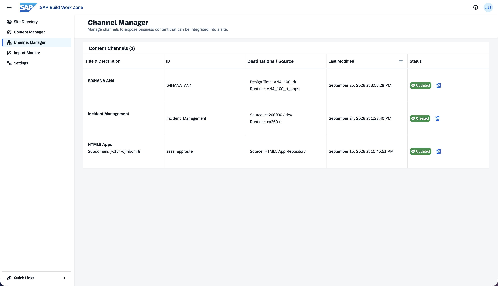

## Exercise 6.2 Reach the Mobile Services Admin Cockpit

1. Open **Settings**. Here you find various tenant-level settings.

2. Select the tab **Mobile Settings** and click the **here** link to open the Mobile Services Admin Cockpit.

    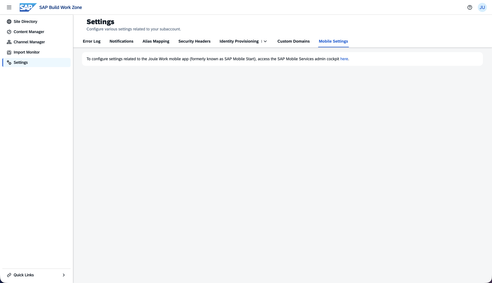

3. When opening the Mobile Services Admin Cockpit, a warning about a technical certificate change appears. Dismiss it. The page underneath shows the available areas for admin tools for the Joule Work mobile app.

    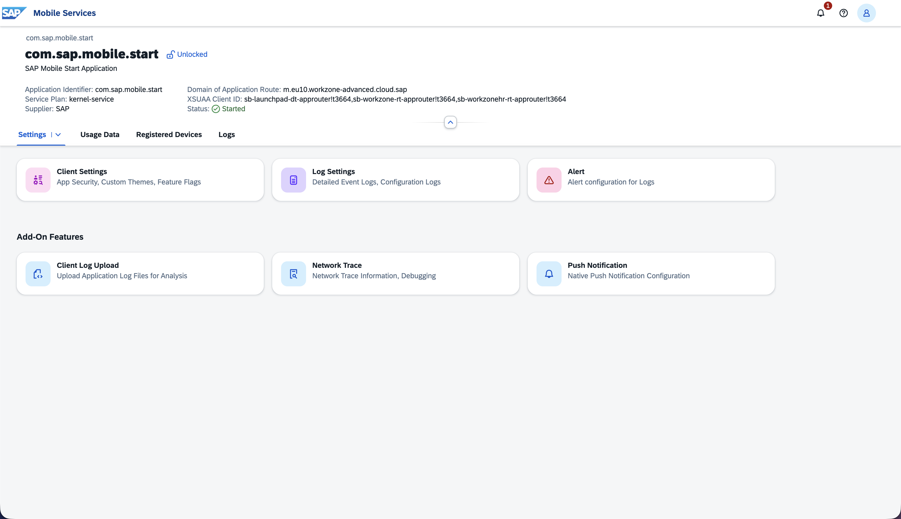

> [!NOTE]
> The Mobile Services Admin Cockpit has its own dedicated admin role. Here too you have been assigned the **Mobile Admin read-only** role.
>
> This Mobile Services Admin Cockpit is provided by **SAP Mobile Services**, a reuse service on SAP BTP for offering mobile apps. It is also used internally, just like the SAP BTP SDK for iOS and Android, to provide the Joule Work mobile app. Note that the previous product name **SAP Mobile Start** still appears in some places, even though the app has already been renamed to **Joule Work**.

## Exercise 6.3 Client Settings and Feature Flags

1. Click **Client Settings**. Here the behavior of the app can be adjusted. For example, we have configured that the user does not have to set and enter an additional passcode or biometric factor when starting the Joule Work mobile app.

    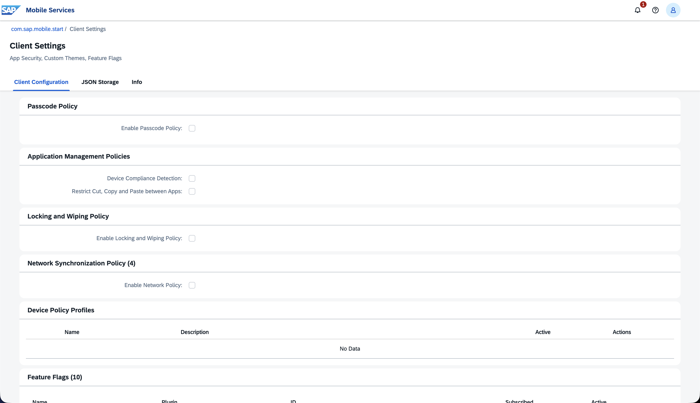

2. Scroll down to the **Feature Flags** area. These are specific features of the Joule Work mobile app that can be switched on or off. For example, if a customer uses SAP Build Work Zone, advanced edition but does not want the Workspaces tab in the Joule Work mobile app, they could switch off the **Advanced Workspaces** toggle.

3. Further down under **Appearance**, the mobile admin can upload a UI5 theme, one for light and one for dark mode, to adapt the look of the mobile app to the customer's corporate identity. In our system none is set.

    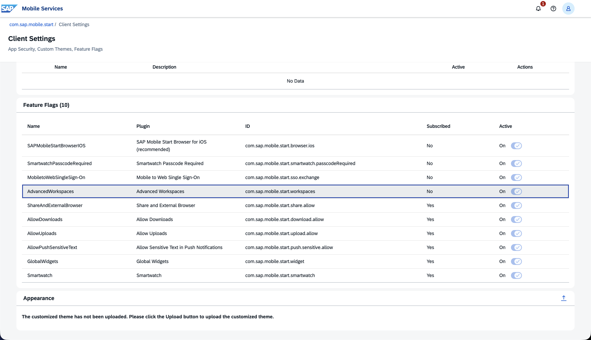

> [!TIP]
> For details on these feature flags, see the [SAP Help documentation on feature flags](https://help.sap.com/docs/joule-work-mobile/administration-guide-sap-build-work-zone-setup/client-settings-and-feature-flags).

## Exercise 6.4 Client Log Upload

1. Go back to the overview in the Mobile Services Admin Cockpit using the **com.sap.mobile.start** link at the top left.

2. Open **Client Log Upload**. Under the tab **Configuration** you can set whether users can upload technical client logs when errors occur. We have already switched this on.

    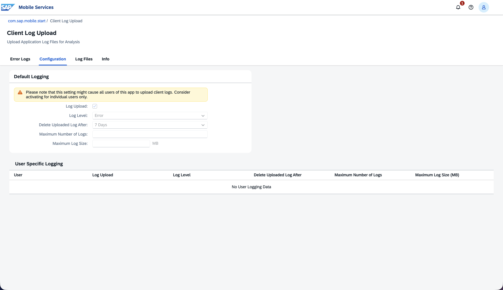

3. Now try out a log upload from the app. In the Joule Work mobile app, open the **Start** tab, tap your **user initials**, and in the **Support** section tap **Upload Logs**.

    <p align="center">
      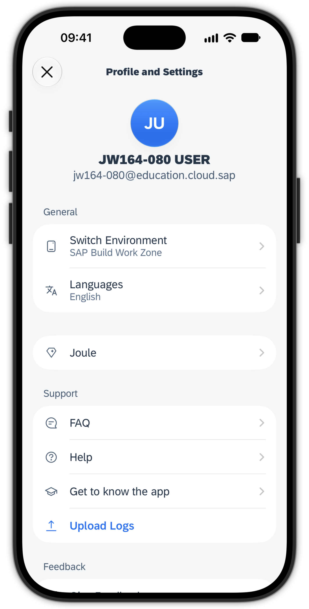
    </p>

4. Back in the Mobile Services Admin Cockpit, select the tab **Log Files**. Your user's uploaded logs should now be listed here.

    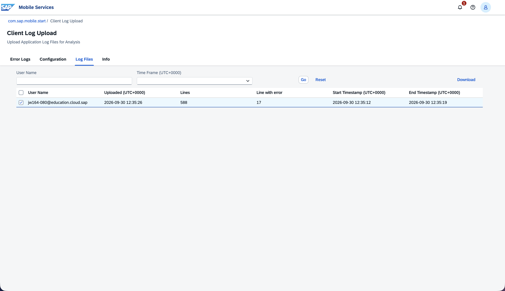

## Exercise 6.5 Network Trace

1. Go back to the overview in the Mobile Services Admin Cockpit using the **com.sap.mobile.start** link at the top left.

2. Open **Network Trace**. This tool is especially important in case of problems and support tickets related to the app. Here a full admin can start a trace for one or more users.

    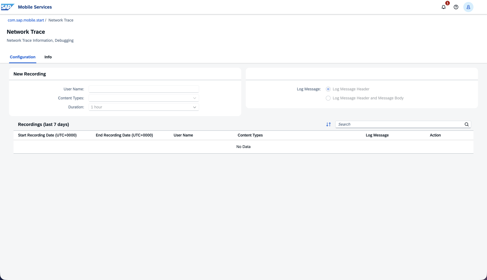

## Summary

You saw the administrator's side of the app across the SAP Build Work Zone Site Manager (Site Directory, Content Manager, Channel Manager) and the Mobile Services Admin Cockpit provided by SAP Mobile Services. You looked at Client Settings and Feature Flags, tried a client log upload end to end, and saw the Network Trace tool used for support. This is what shapes the experience end users get on their devices.

This concludes Part 1. Continue to Part 2 - [Exercise 7 - Explore Joule Work on the web](../ex7/README.md)
