# Exercise 7 - Explore Joule Work on the web

Part 2 shifts to the other experience. Instead of connecting through SAP Build Work Zone, you now work with **Joule Work** directly: the AI-native working environment built around Joule. You start on the web to get familiar with its two core features, Conversations and Spaces, before switching the app on your phone.

## Exercise 7.1 Sign in to Joule Work

1. On the computer at your desk, open a browser and go to the Joule Work site:

    ```text
    https://747238487.eu10.sapdas.cloud.sap/new
    ```

2. When prompted, sign in with the **same credentials** you used in Exercise 1, that is your desk user `JW164-0##` and the password the instructor gave you.

> [!CAUTION]
> Keep using **your** assigned desk number consistently. The conversations and content you create are tied to your user.

3. You land on **Conversations** in a fresh, empty conversation. This is the direct entry point into Joule, without the SAP Build Work Zone shell around it.

    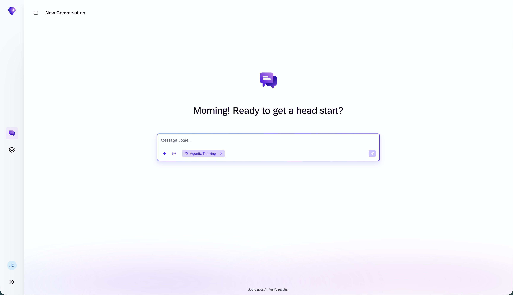

## Exercise 7.2 Start a conversation

1. Every new conversation opens with **Agentic Thinking** already active, shown as a chip in the **Message Joule** field. To get a feel for the classic assistant first, click the **X** on the **Agentic Thinking** chip to turn it off.

2. In the **Message Joule** field, start some small talk. For example, greet Joule and ask it to explain what SAP TechEd is.

3. Read the answer. Without Agentic Thinking, Joule responds like a classic assistant: it answers from its trained knowledge and offers to help further.

    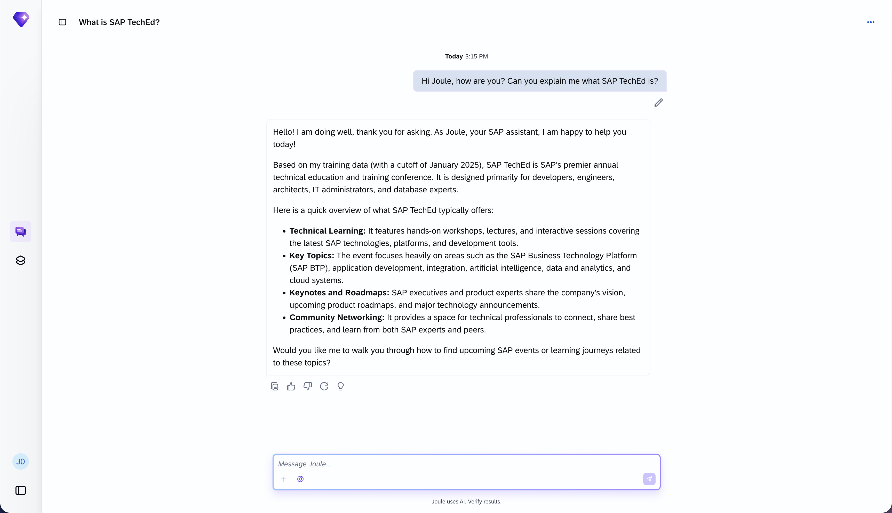

4. Next to the conversation title at the top left, click the panel button to open the **conversation list**. Here all your conversations are collected so you can jump between them.

    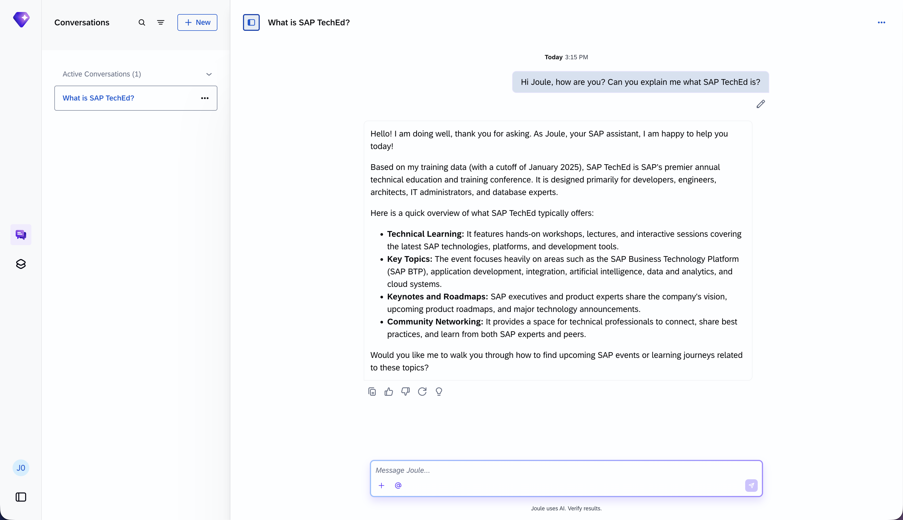

5. In the list, click **+ New** to start another conversation.

## Exercise 7.3 Work with an assistant

> [!NOTE]
> For now, **Agentic Thinking** has to be switched off to talk to a specific assistant. In the future this will also be possible with Agentic Thinking enabled.

1. The new conversation again starts with **Agentic Thinking** active. To route your request to a specialized assistant, first click the **X** on the **Agentic Thinking** chip to turn it off.

2. In the **Message Joule** field, click the **@** button. A list of available **assistants** appears, each specialized for a particular business area, for example the **Sourcing Assistant** for procurement or the **SAP LeanIX Joule Capabilities**.

3. Select the **@Billing Assistant**. It automates and accelerates billing operations: prioritizing the billing due list, creating and adjusting billing documents, identifying billing anomalies, and helping resolve posting issues.

    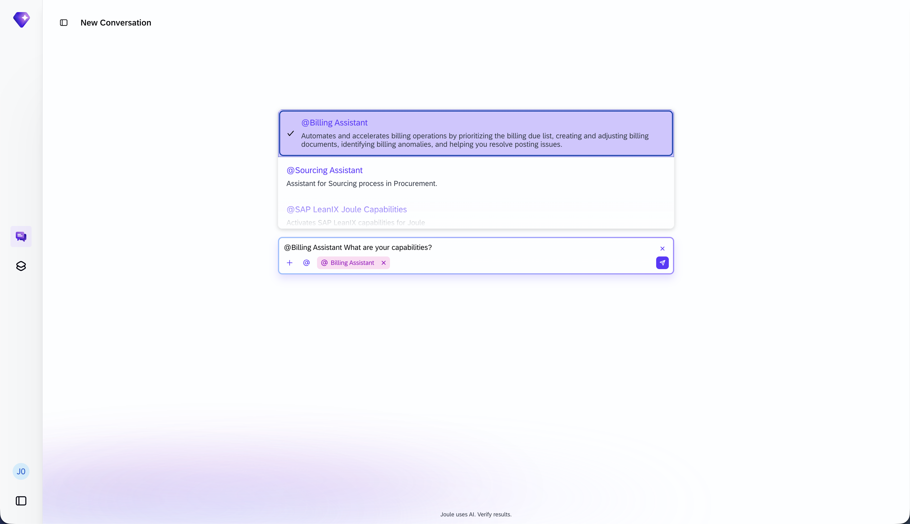

4. With the assistant selected, ask it:

    ```text
    What are your capabilities?
    ```

    Read the answer. Unlike the general Joule conversation, the response is scoped to the assistant's billing domain, so you get focused, specialized help for billing topics.

> [!TIP]
> Use **@** whenever you have a task in a specific area. Routing the request to the right assistant gives you more precise results than a general prompt.

## Exercise 7.4 Switch to Agentic Thinking

1. Open the **conversation list** again and click **+ New** to start another conversation. This time, leave the **Agentic Thinking** chip in place. Every new conversation starts with Agentic Thinking active, so Joule's orchestration already runs in the agentic harness instead of the classic approach: it can plan, take initiative, and act across multiple steps autonomously.

2. Ask a question and watch how the way of working and the style of the answer change. Joule reasons through the task and returns a richer, more structured response.

    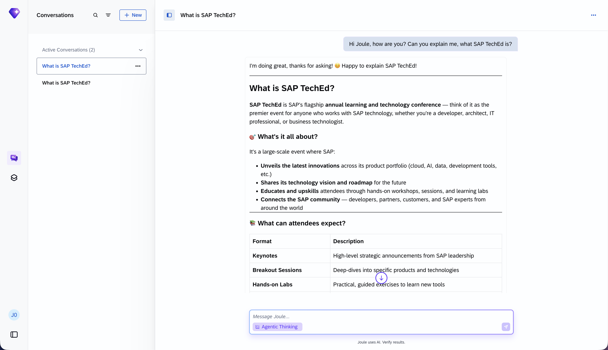

## Exercise 7.5 Explore Skills

1. Click your **user initials** at the bottom left, and in the menu select **Explore Skills**.

    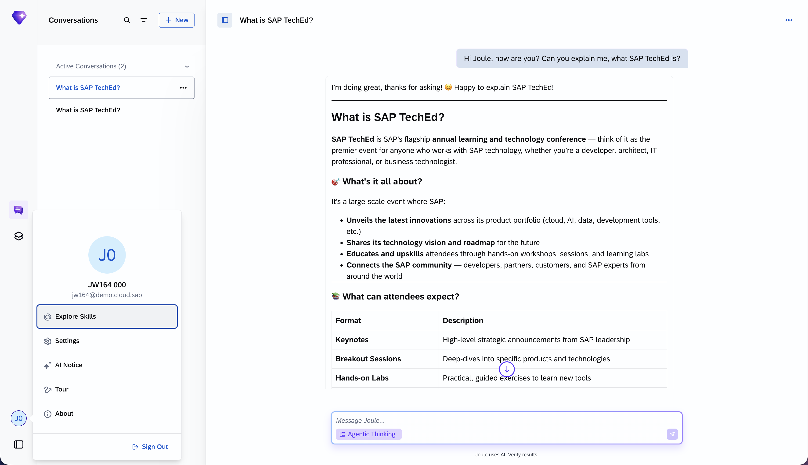

2. Here you can switch the skills provided by SAP on and off, and you can also upload your **own skills**. Skills extend the Agentic Thinking mode and teach Joule new capabilities, for example working with `docx`, `pdf`, or `pptx` files, or connecting to SAP S/4HANA, SAP Ariba, and SAP SuccessFactors.

    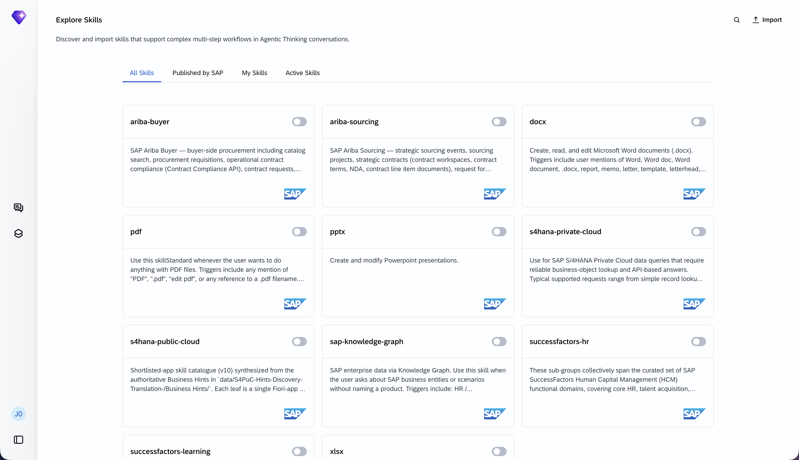

> [!TIP]
> Browse the **All Skills**, **Published by SAP**, **My Skills**, and **Active Skills** tabs to see what is available and what is currently switched on for you.

## Exercise 7.6 Import your own skill

Beyond the skills published by SAP, you can bring your own. For this session we prepared a small skill that knows the SAP TechEd 2026 session catalog and can recommend sessions. You import it now and use it later on your phone in Exercise 9.

> [!NOTE]
> For security reasons, custom skills run in a sandbox.

1. Download the skill as a ZIP file. The link downloads `sap-teched-2026-skill.zip` straight to your computer:

    [Download sap-teched-2026-skill.zip](https://github.com/SAP-samples/teched2026-JW164/raw/main/exercises/ex7/sap-teched-2026-skill.zip)

2. Open your **Downloads** folder, locate `sap-teched-2026-skill.zip`

3. Right-click the zip file and select **Extract all**.

    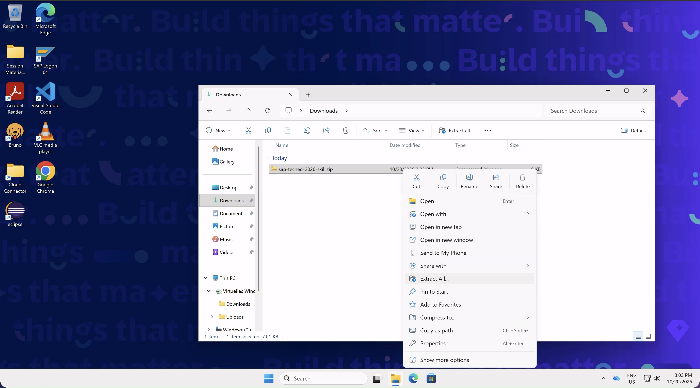

4. In the **Select a Destination and Extract Files** dialog, keep the suggested folder and click **Extract**. On Windows you end up with a folder named **sap-teched-2026-skill**, which contains another folder called **sap-teched-2026** that holds a `SKILL.md` file and an `assets` subfolder.

    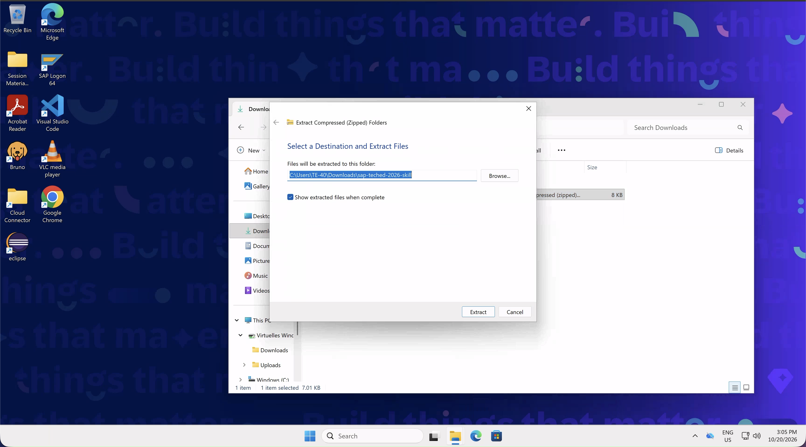

    > [!TIP]
    > On Mac, you can extract the zip file by double-clicking it. You end up directly with the **sap-teched-2026** folder, without the extra **sap-teched-2026-skill** level.

5. Back in **Explore Skills**, click **Import** at the top right.

    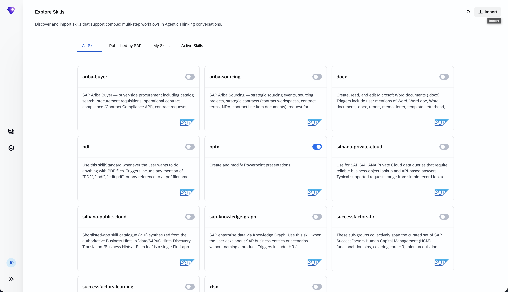

6. In the **Import Skill** dialog, click **Choose Folder**.

    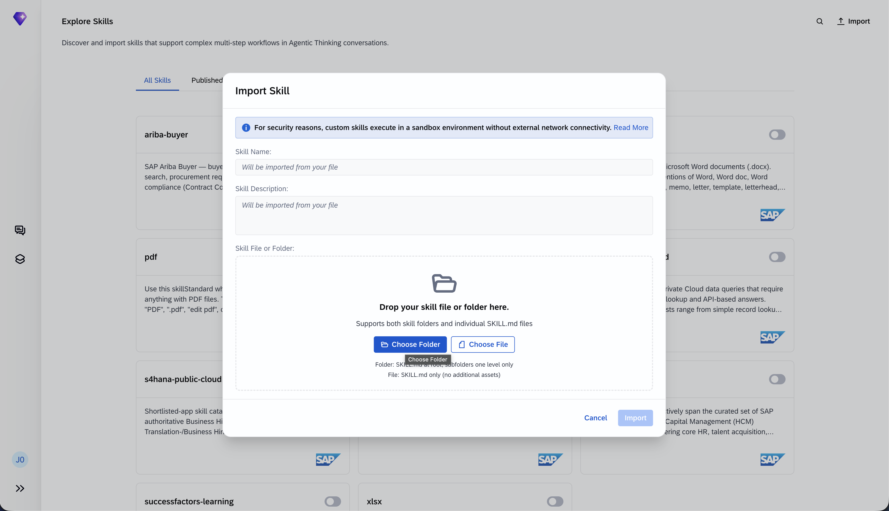

7. Navigate via **Downloads** into the extracted **sap-teched-2026-skill** folder, select the **sap-teched-2026** folder, and confirm by pressing **Upload**.

    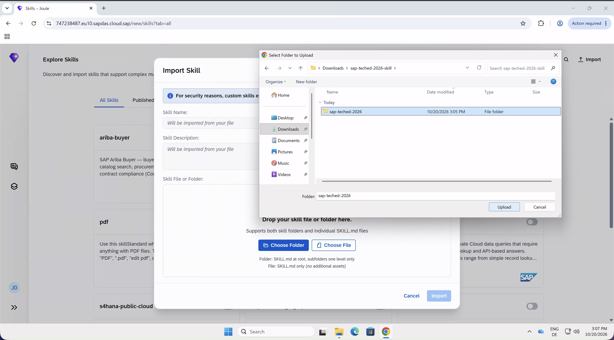

8. The **Skill Name** and **Skill Description** fill in automatically from the folder, and the drop area confirms `sap-teched-2026 (5 files)`. Click **Import** at the bottom right.

    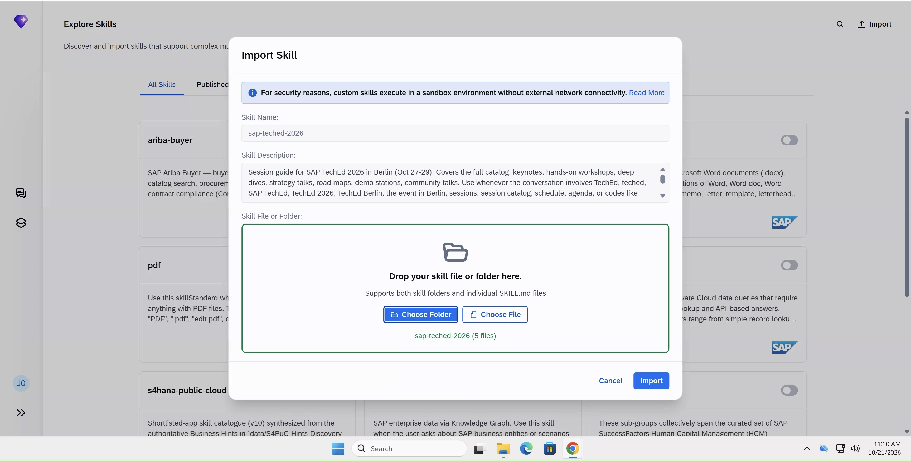

9. Switch to the **My Skills** tab. The **sap-teched-2026** skill now appears there. Turn it on with the **toggle** so Joule can use it in Agentic Thinking.

    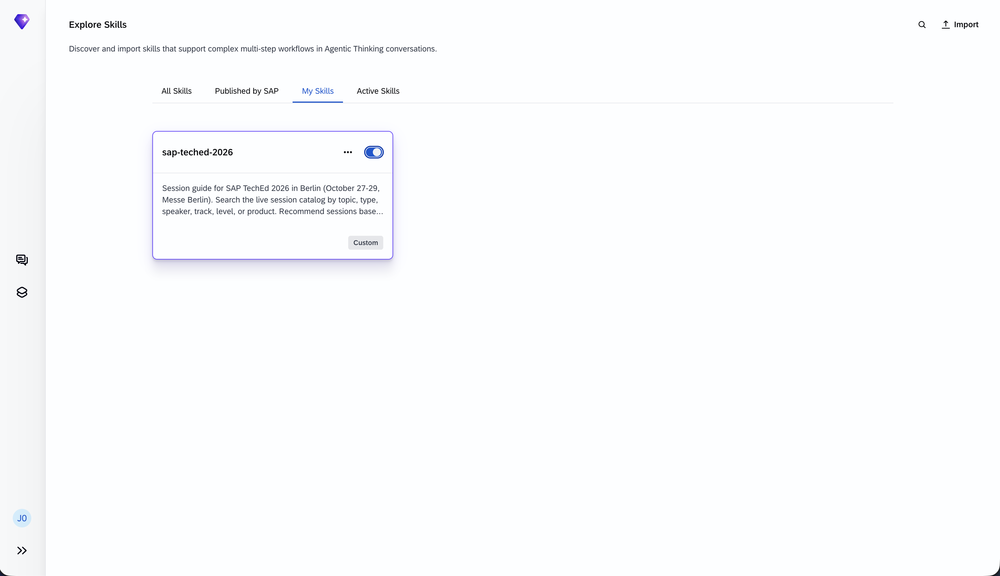

## Exercise 7.7 Spaces

1. In the left menu, switch to **Spaces**. We have already created several Spaces for all users. Spaces are areas that hold flexible, AI-generated UI elements, populated with data from the systems and data sources available to Joule.

2. Open the **Production Planning** Space and explore its rich content: a Demand Forecast line chart, a Production Orders breakdown, Supplier Gaps, and Revenue at Risk.

    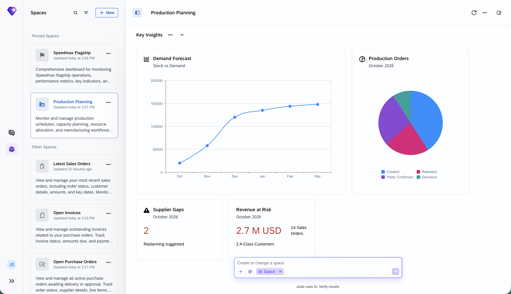

3. Interact with the analytical cards and graphs. Hover over the data points of the Demand Forecast chart and the segments of the Production Orders breakdown to inspect the underlying values.

4. Afterwards, open the **Speedmax Flagship** Space and explore its sample content: the Speedmax Q3 Performance indicators, the Speedmax Retail Sell-Through bar chart, and the Supplier Gap Analysis.

    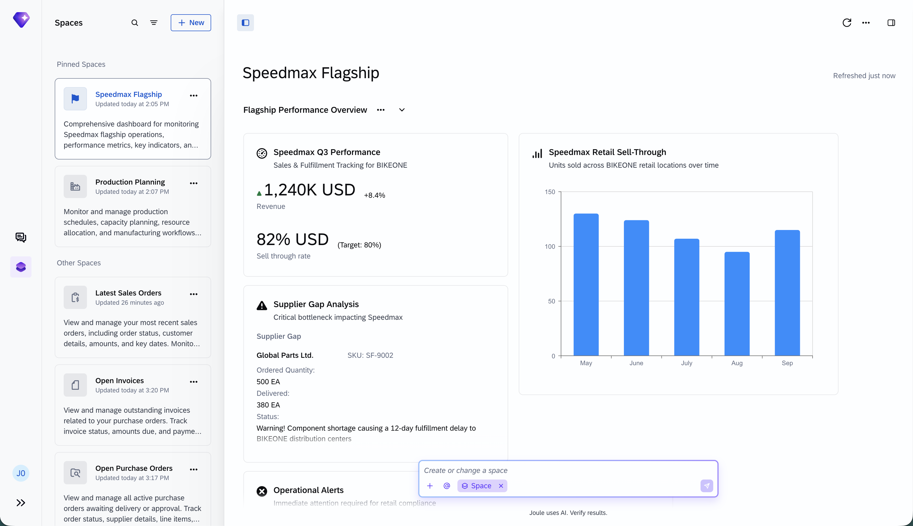

> [!NOTE]
> None of this UI was hand-built. Joule generated it from the user's intent, after loading the relevant data from the connected systems. The layout, cards, and charts are produced on the fly to fit the data and the question at hand. Later, on the phone, you will create a brand-new Space of your own directly from the Joule Work mobile app and watch Joule assemble it from live SAP S/4HANA data.

## Summary

You explored Joule Work on the web and its two core features: Conversations, where you work with Joule in natural language, and Spaces, which organize work into AI-generated, data-driven contexts. Along the way you saw that every conversation starts in Agentic Thinking mode, turned it off for a classic exchange and to reach the specialized Billing Assistant with **@**, kept it on for an agentic conversation, saw how skills extend what Joule can do, and imported your own **sap-teched-2026** skill for later. Next you bring this experience to your phone.

Continue to - [Exercise 8 - Switch the app to Joule Work](../ex8/README.md)
