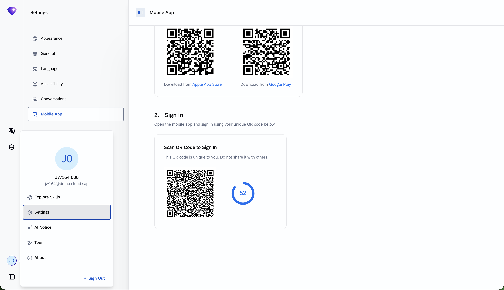
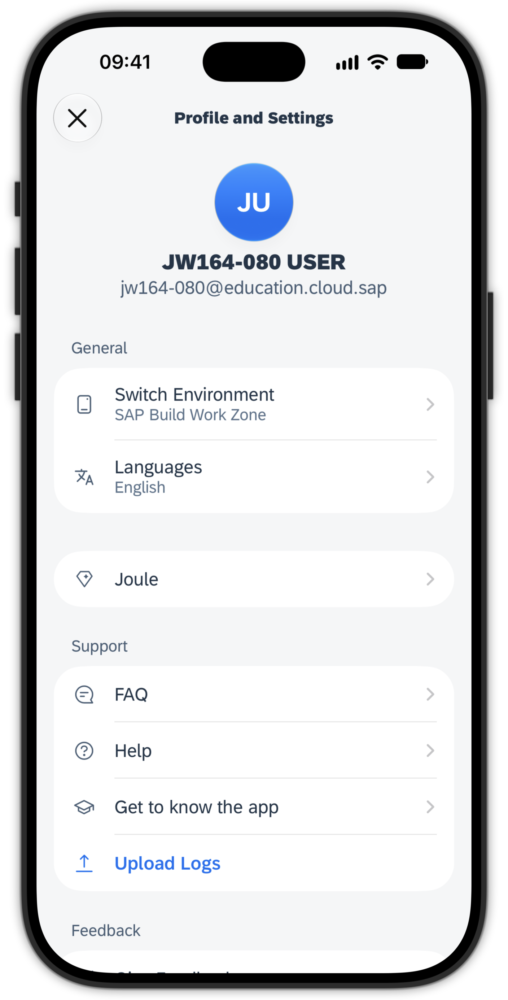
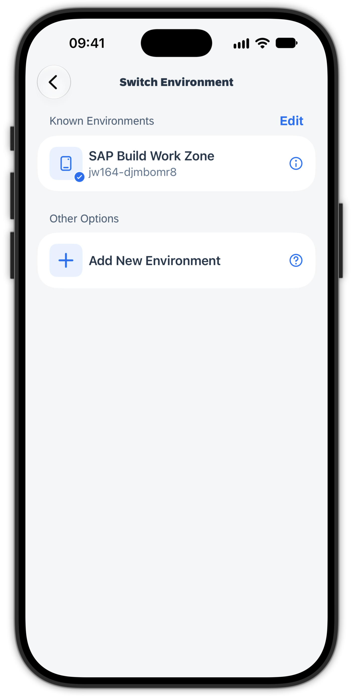
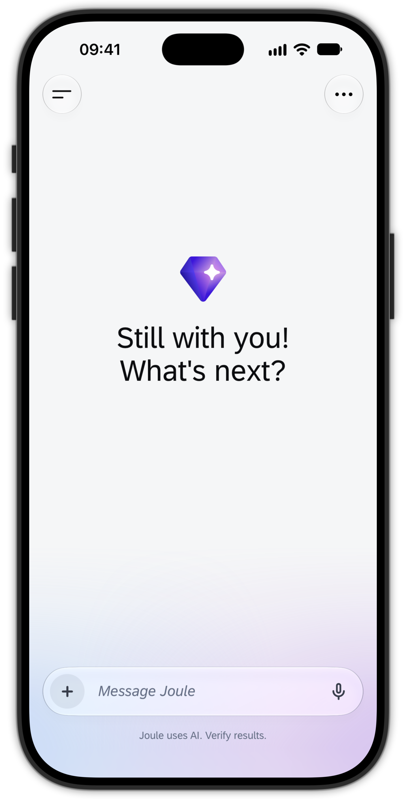

# Exercise 8 - Switch the environment of the mobile app to Joule Work

Here is the moment the two halves of the session come together: the **same app** on your phone can connect to a different environment. Using the **Switch Environment** feature, you move the Joule Work mobile app from your SAP Build Work Zone site to Joule Work, and you experience a much smoother onboarding along the way.

## Exercise 8.1 Open the Mobile App settings in Joule Work

1. Back in Joule Work on the web (from Exercise 7), click your **user initials** at the bottom left, and in the menu select **Settings**.

2. In the settings, choose the entry **Mobile App**. This screen shows the QR codes for installing the app from the Apple App Store and Google Play.

    

> [!NOTE]
> The Joule Work mobile app is the **same app** you already onboarded in Exercise 2. Because Joule Work uses the same app, there is **nothing new to download**. Leave this page open, you return to it in Exercise 8.3.

## Exercise 8.2 Add a new environment in the app

Your Joule Work mobile app is currently still connected to SAP Build Work Zone. Instead of a fresh install, you point the same app at Joule Work.

1. Open the Joule Work mobile app on your phone. On the **Start** tab, tap your **user initials** to open the **Profile and Settings** screen.

2. Choose **Switch Environment**.

> [!TIP]
> You could also tap **Sign out** here. **Switch Environment** exists to make moving between environments easier: it keeps your known environments in a list so you can switch back and forth without re-entering connection details each time.

3. In the **Switch Environment** screen, your current **SAP Build Work Zone** environment is listed under **Known Environments**. Tap **Add New Environment** and confirm the dialog.

> [!NOTE]
> Confirming signs you **out** of the SAP Build Work Zone system, but keeps it remembered in the list so you can switch back to it later.

  
  

## Exercise 8.3 Sign in with the personalized QR code

1. Back in Joule Work on the web, on the **Mobile App** page scroll down to **2. Sign In**.

2. Press the **refresh** button. After a moment, a QR code appears together with a **60 second countdown**.

3. On your phone, scan this QR code with the Joule Work mobile app **before the countdown runs out**. If it expires, press refresh again to generate a new one.

> [!TIP]
> Unlike the SAP Build Work Zone Register QR code in Exercise 2, this QR code is **not** static for the landscape. It is **personalized** to the user currently signed in on the web, is only valid for a limited time, and can be used **only once**. It transfers your web session straight into the mobile app, so no additional login is needed on the phone.

## Exercise 8.4 Land in Joule Work on mobile

1. After scanning, you are signed in to the Joule Work mobile app **directly**, without a manual login on the phone, and you land on the **Joule conversation** screen.

    

      
    

2. This conversation screen corresponds to the **Conversations** screen in Joule Work on the web that you explored in Exercise 7. The app is now connected to Joule Work.

## Summary

You switched the same app from your SAP Build Work Zone site to Joule Work using **Switch Environment**, and saw the streamlined QR onboarding that carries your web session to the device without a manual login. Unlike the static Register QR code in Exercise 2, the Joule Work sign-in QR is personalized, time-limited, and single-use. The app is now connected to Joule Work, ready for you to explore on mobile.

Continue to - [Exercise 9 - Explore Joule Work on mobile](../ex9/README.md)
