# Exercise 9 - Explore Joule Work on mobile

With the app now connected to Joule Work, you experience the AI-native environment on your phone. The two core features you explored on the web in Exercise 7, Conversations and Spaces, are here too, tuned for mobile and in sync with the web.

## Exercise 9.1 Small talk, with and without Agentic Thinking

Just as you did on the web in Exercise 7, start by getting a feel for the different ways Joule works and answers, this time on mobile.

1. The conversation opens with **Agentic Thinking** active, shown as a chip in the **Message Joule** bar just like on the web. To try the classic assistant first, tap the **X** on the **Agentic Thinking** chip to turn it off.

2. In the **Message Joule** field, start some small talk. For example, greet Joule and ask it to explain what SAP TechEd is. Without Agentic Thinking, Joule responds like a classic assistant, answering from its trained knowledge.

3. To switch back, open the **+** menu and choose **Agentic Thinking** again, then ask a question. Watch how the way of working and the style of the answer change: Joule reasons through the task and returns a richer, more structured response, just as it did on the web.

    <p align="center">
      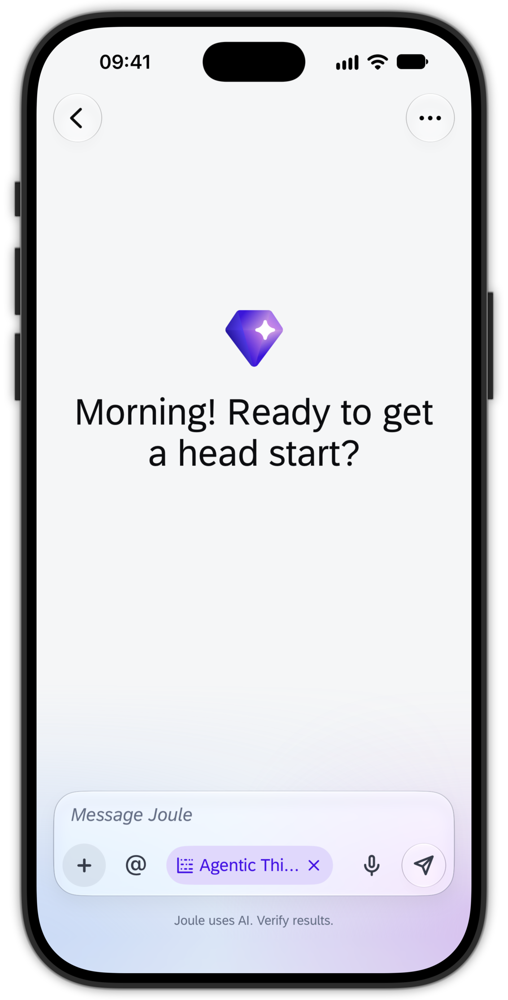
    </p>

> [!TIP]
> The mode selection lives at the **+** button on mobile too, so you can switch between the classic and the agentic way of working without leaving the conversation.

## Exercise 9.2 Get a session recommendation from your skill

In Exercise 7 you imported the **sap-teched-2026** skill and switched it on. Now you put it to work on your phone. Skills run in Agentic Thinking, so Joule can call the skill, search the SAP TechEd 2026 session catalog, and come back with a recommendation.

1. Tap the **three dots** button at the top right and start a **new conversation**.

2. Make sure **Agentic Thinking** is active, shown as a chip in the **Message Joule** bar. If it is off, open the **+** menu and choose **Agentic Thinking**.

3. Ask Joule:

    ```text
    Can you recommend me a hands-on session at SAP TechEd 2026? I am interested in Joule Work and mobile.
    ```

4. Joule calls the sap-teched-2026 skill, searches the session catalog, and returns a recommended session with its session code, track, date, time, and location. Use it to plan the rest of your SAP TechEd.

    <p align="center">
      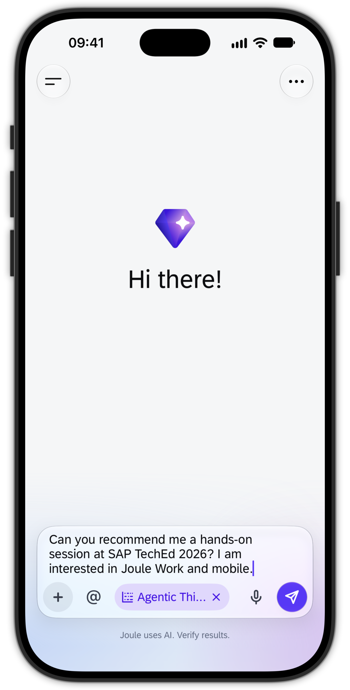
      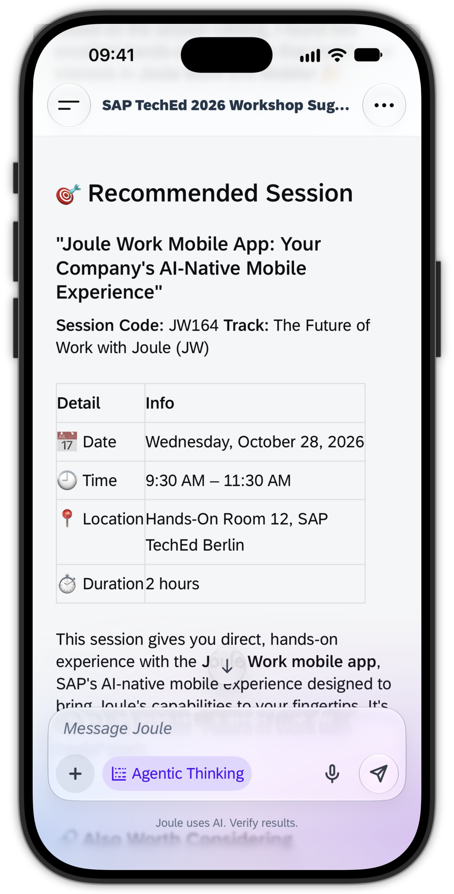
    </p>

> [!TIP]
> Ask follow-up questions to refine the recommendation, for example by track, day, or your job role, and let the skill narrow the catalog down to what fits you best.

## Exercise 9.3 Start new conversations and open the sidebar

1. To begin a fresh conversation, tap the **three dots** button at the top right and start a **new conversation**.

2. To move around the app, tap the **list** button at the top left to open the **sidebar** menu. Here you find the same areas of Joule Work as on the web: **Conversations** and **Spaces**. Under **Recent Conversations** you have quick access to your latest conversations.

3. Tap the **Conversations** menu item to open the full **conversation list**, where all your conversations are grouped into **Active** and **Expired**.

    <p align="center">
      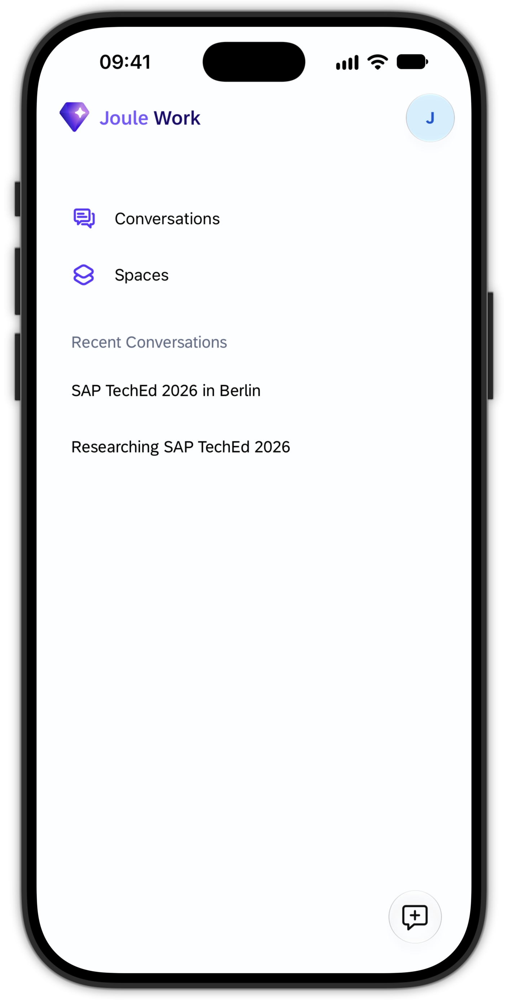
      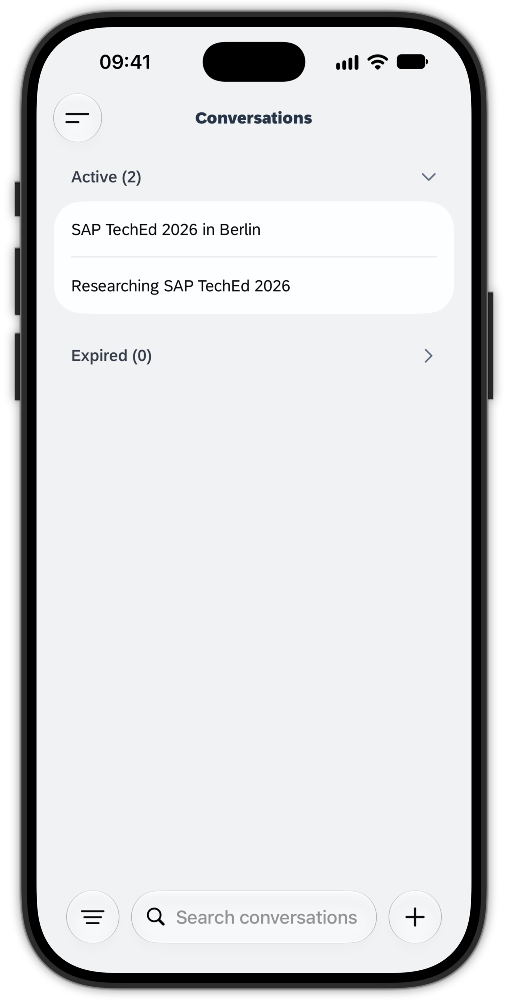
    </p>

## Exercise 9.4 Work with the Billing Assistant

Now repeat the assistant interaction from the web, this time on your phone.

> [!NOTE]
> For now, **Agentic Thinking** has to be switched off to talk to a specific assistant. In the future this will also be possible with Agentic Thinking enabled.

1. On the **Conversations** screen, tap the **+** button at the bottom right to create another new conversation.

2. The new conversation again starts with **Agentic Thinking** active. Tap the **X** on the **Agentic Thinking** chip to turn it off.

3. Place the focus in the **Message Joule** box, then tap **@** to open the list of available **assistants**, each specialized for a particular business area. Select the **@Billing Assistant**.

4. With the assistant selected, ask it:

    ```text
    What are your capabilities?
    ```

    Just like on the web, the response is scoped to the assistant's billing domain, so you get focused, specialized help.

    <p align="center">
      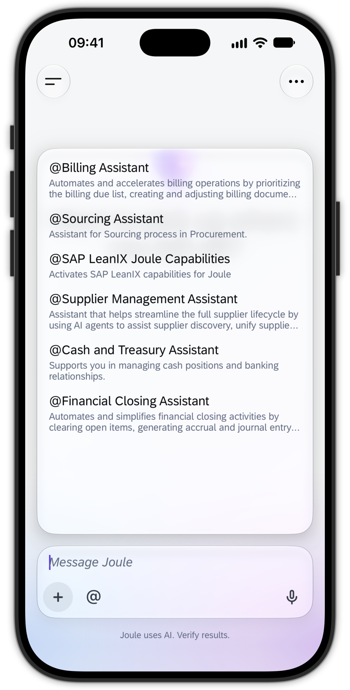
      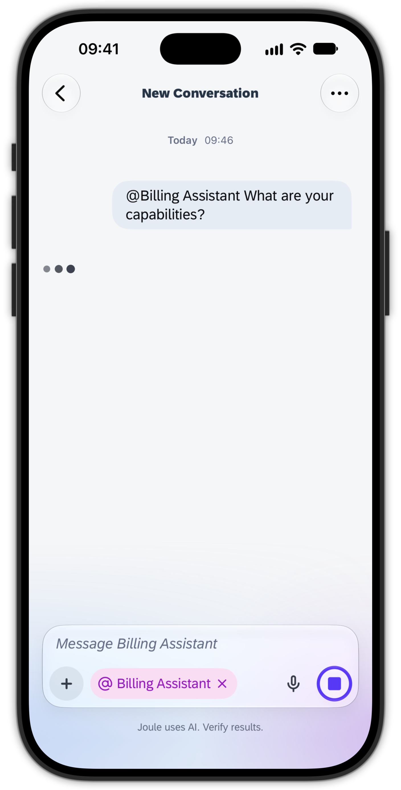
    </p>

## Exercise 9.5 Explore the pre-created Spaces on mobile

1. Open the **sidebar** menu again and navigate to **Spaces**. You have access to the **same Spaces** here as on the web, including the **Production Planning** and **Speedmax Flagship** Spaces you explored on the web.

2. Open the **Production Planning** Space, the same one you observed on the web. Pay particular attention to how the UI elements generated with generative AI are rendered **natively** on mobile. The charts and analytical cards are not static images: they are fully interactive native charts you can tap and explore.

3. Tap a segment of the Production Orders chart, or a point on the Demand Forecast line, to open a native tooltip with the exact values behind it.


4. Go back to the **Spaces** list and open the **Speedmax Flagship** Space. Observe and compare how its elements, the performance indicators and the Retail Sell-Through bar chart, render natively and react to your taps just like in Production Planning.

    <p align="center">
      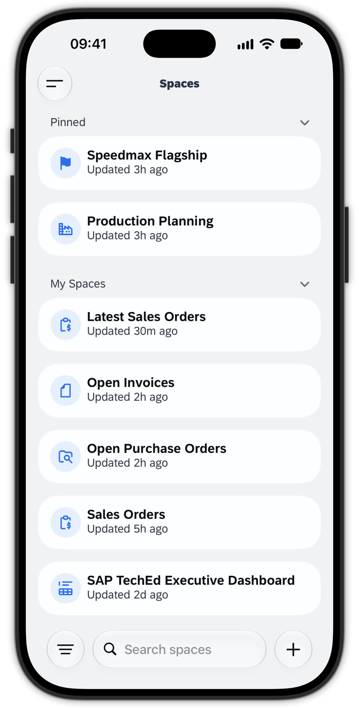
      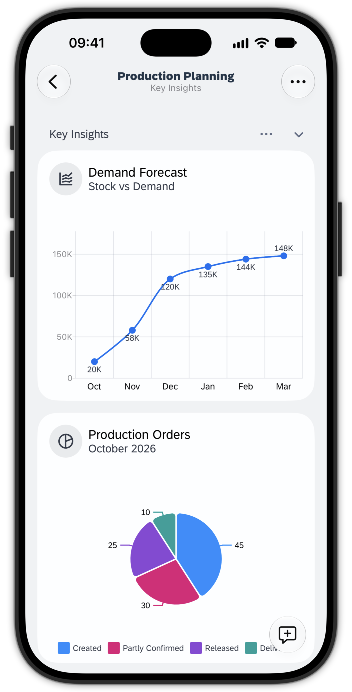
    </p>

    <p align="center">
      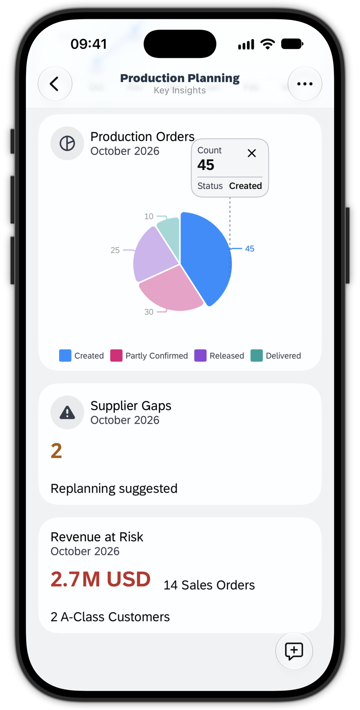
      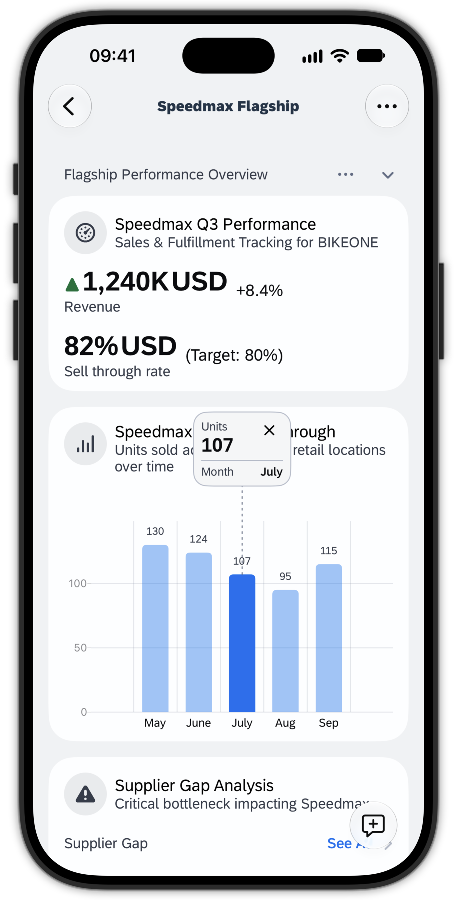
    </p>

## Exercise 9.6 Create a new Space from the mobile app

So far you explored Spaces that were prepared for you. Now you create your own, directly from the phone, and watch Joule build it from live SAP S/4HANA data.

> [!NOTE]
> You start here from the Spaces list, but you can also create a Space from within a **Conversation**, by keeping the **Space** option selected in the message bar before you send your prompt.

1. Go back to the **Spaces** list and tap the **+** button at the bottom right to start a new Space.

2. In the **Create or change a space** field, enter the prompt:

    ```text
    Create a Space that displays the latest Sales Orders
    ```

3. Send the prompt. Joule creates a new Space, fetches the required data from the SAP S/4HANA system, and generates suitable UI elements for it. This may take a short moment.

    <p align="center">
       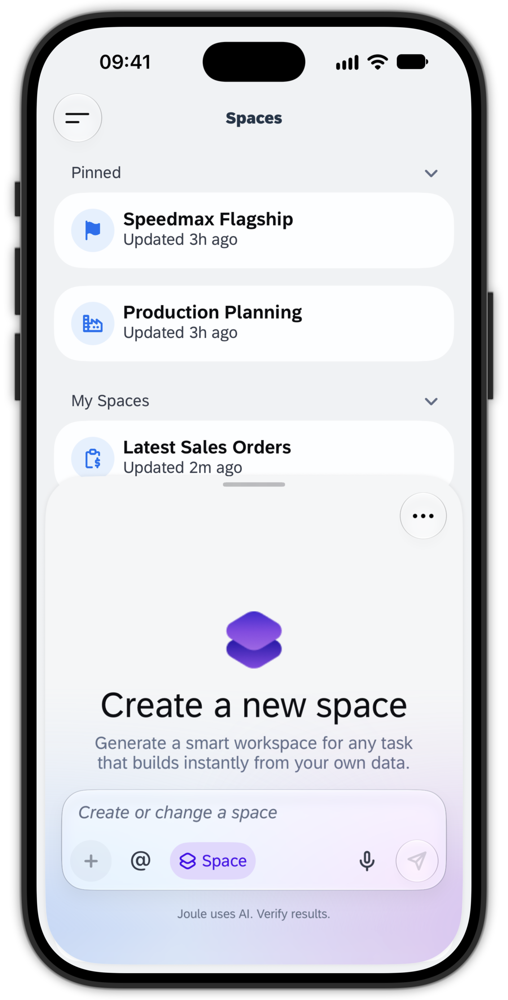
      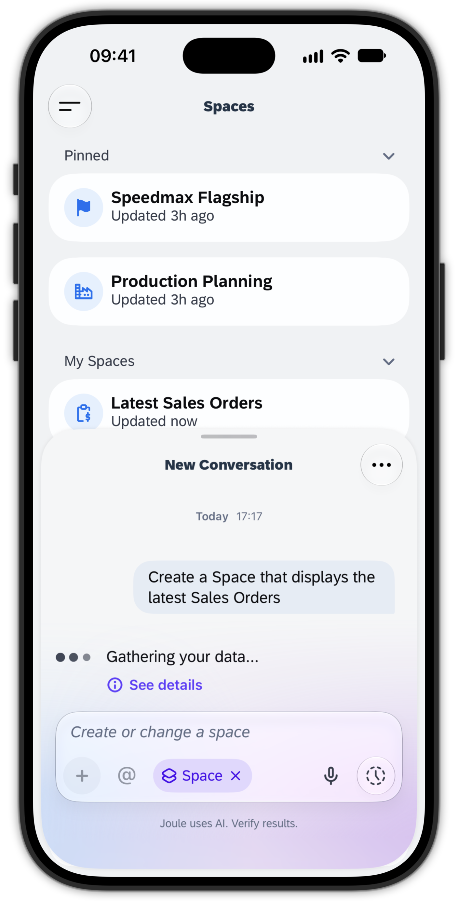
    </p>

> [!TIP]
> While Joule works, tap **See details** to follow along with the individual steps Joule is taking to complete the task.

## Exercise 9.7 Open the new Space and explore the Sales Orders

1. Dismiss the Conversation sheet and open the Space that Joule just created for you. It shows a table of the latest sales orders.

2. Open the **same Space on the web** and compare the two. Notice how the wide table is rendered differently on each device to make the best use of the available screen estate: full columns on the web, a compact card-style list on the phone.

3. Back on the phone, tap **See All** in the Sales Orders table, then select the first entry to open the full details of that sales order.

    <p align="center">
      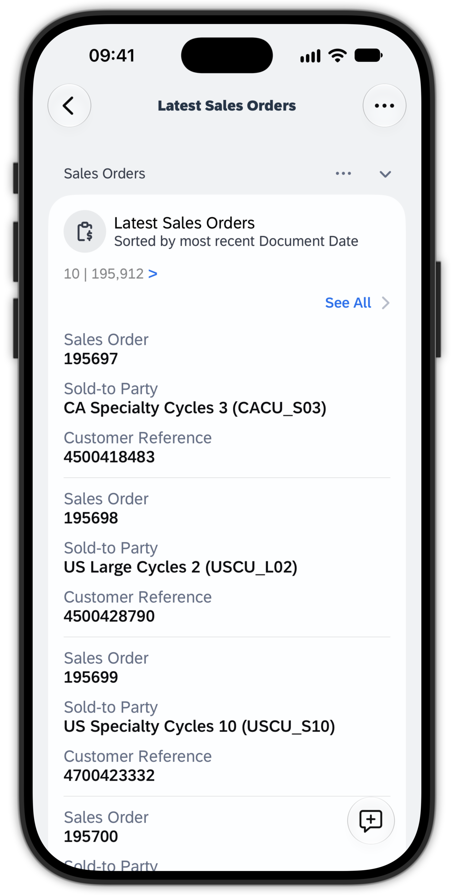
      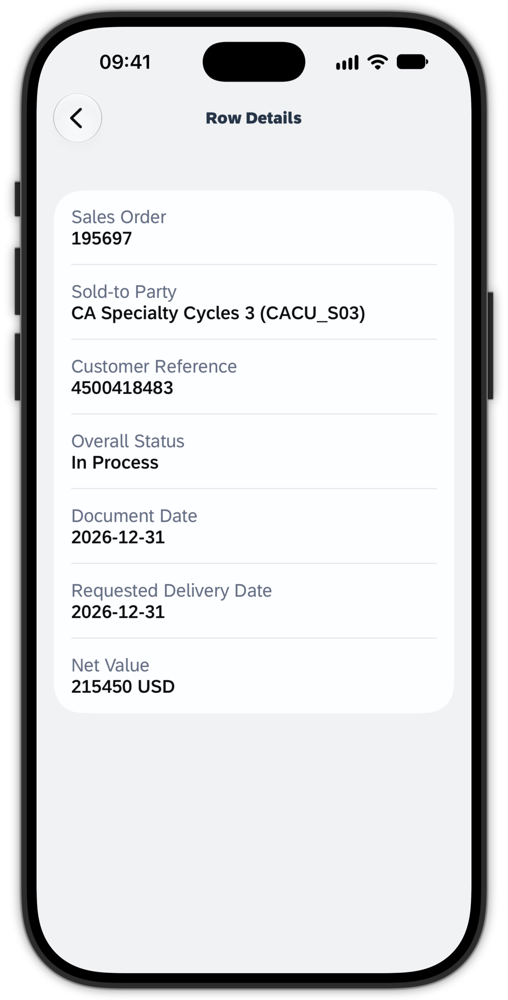
    </p>

    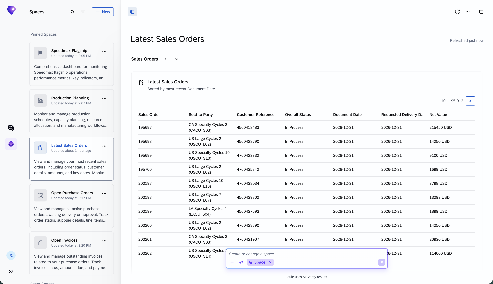

## Exercise 9.8 Continue the conversation inside the Space

1. Go back to the Space and tap the **conversation** button at the bottom right. Ask Joule a follow-up question:

    ```text
    can you provide me details for the first sales order visible in the space?
    ```

    After a short moment, a new card with the order details appears on the Space's canvas.

    <p align="center">
      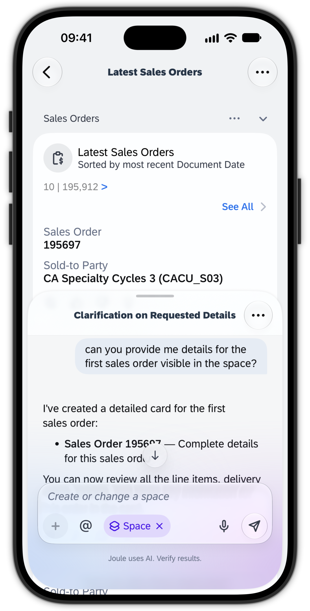
      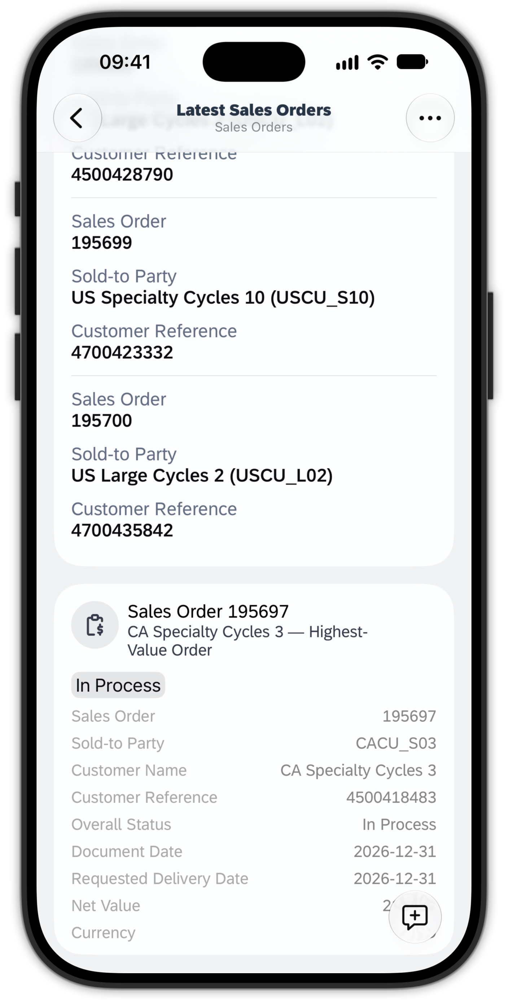
    </p>

2. Open the Conversation sheet for this Space again and ask Joule:

    ```text
    Can you also add a card with details of the customer of Sales Order 195697
    ```

    <p align="center">
      
    </p>

3. Once Joule is done, inspect the new elements on the Space's canvas: a customer account card now sits alongside the sales order details, all generated on the fly from your conversation.

    <p align="center">
      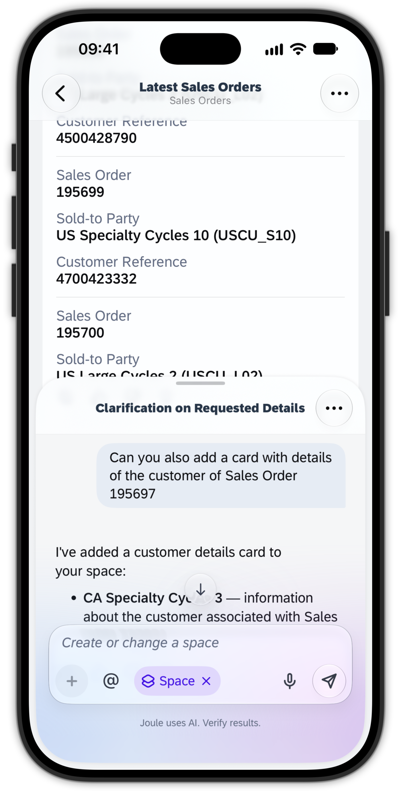
      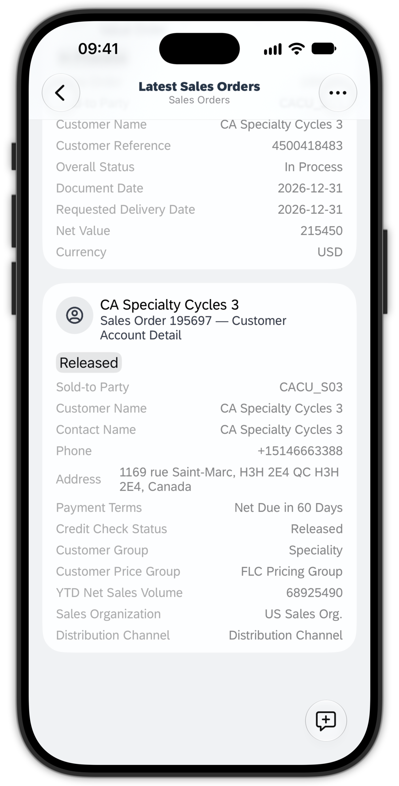
    </p>

## Exercise 9.9 Dictate with your voice

1. In the message bar, tap the **microphone** button to start **Dictation**.

2. Speak your prompt instead of typing it, then send it. Dictation is a natural fit on mobile when your hands are busy or you simply prefer to talk to Joule.

    <p align="center">
      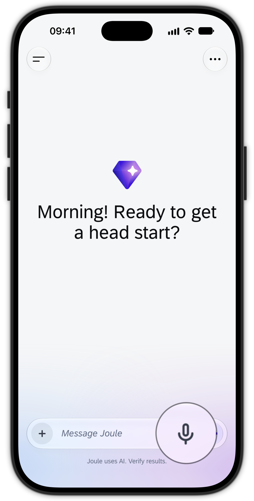
    </p>

## Exercise 9.10 Bonus - Voice Mode

> [!NOTE]
> This is a bonus exercise. Voice Mode works best somewhere quiet, so feel free to come back and try it after the session, at a calmer spot. Please avoid doing this in the hands-on exercise room to not disturb the other participants.

Beyond dictating single prompts, Joule can hold a full spoken conversation with you in **Voice Mode**: you talk, Joule talks back, hands-free.

1. In the message bar, tap the **X** on the **Agentic Thinking** chip to turn it off. For now, Voice Mode requires Agentic Thinking to be turned off.

2. Tap the purple **voice** button on the right of the message bar to start **Voice Mode**.

3. When Joule greets you with "Hi, I'm listening. Talk to me naturally.", just speak. Joule listens, answers out loud, and keeps the conversation going in a natural back-and-forth.

4. Tap the **X** button to end Voice Mode and return to the conversation.

    <p align="center">
      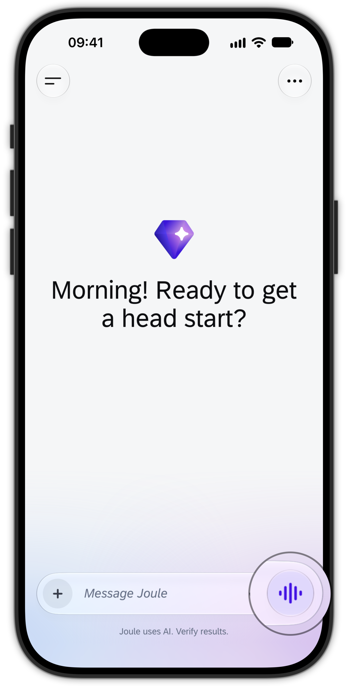
      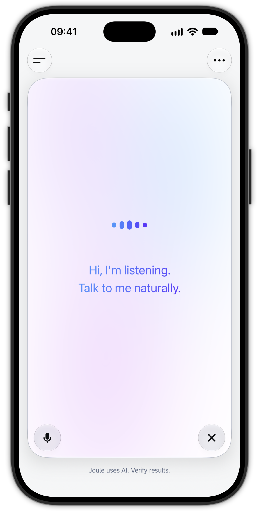
    </p>

> [!TIP]
> Its availability also depends on an admin toggle: in the **Joule Admin Center**, under **Joule Feature Selection**, the **Joule Voice for Mobile** feature decides whether users in the tenant can use voice with Joule and hear spoken responses. For details, see [Getting Started with Joule Work - For Administrators](https://help.sap.com/docs/joule/joule-work-621104a90a01407fbb2d1613db39a54d/getting-started-with-joule-work#for-administrators).

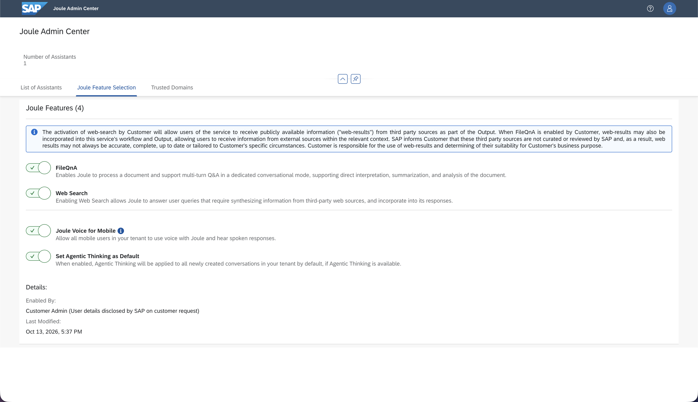

## Summary

You experienced Joule Work on mobile: Conversations and Spaces on your phone, in sync with the web. You compared the classic and Agentic Thinking modes, let your imported **sap-teched-2026** skill recommend a session, and routed a request to the Billing Assistant with **@**. In Spaces you saw AI-generated content rendered as fully interactive native charts, then created a brand-new Space straight from the phone, watched Joule build it from live SAP S/4HANA data, and extended it further through follow-up questions that added new cards to the canvas. You also dictated a prompt with your voice, and you can come back to **Voice Mode** for a full hands-free conversation with Joule. Across this session you saw one app serve two experiences, your Intelligent Enterprise through SAP Build Work Zone, and the AI-native environment through Joule Work, and how it becomes the mobile foundation for your company's transition to an autonomous, AI-native way of working.

> [!IMPORTANT]
> **Congratulations!** 🎉 You have completed the JW164 hands-on session.
> Thank you for joining. For questions about the Joule Work mobile app, reach the product team at [jouleworkmobile@sap.com](mailto:jouleworkmobile@sap.com).
